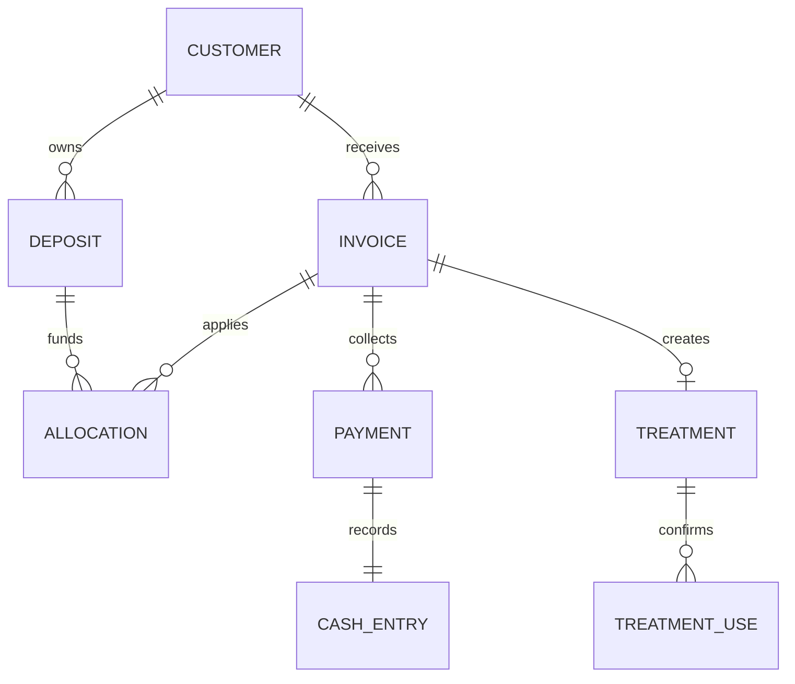

# Thiết kế chuyển đổi SpaCare

## Sửa lỗi hiển thị và điều hướng — 21/10/2026

- Bộ lọc danh sách lưu tại query parameter `search`. Mở hóa đơn sau hoàn thành lịch, bấm mã HĐ hoặc mã lịch đều mang mã đầy đủ sang URL đích. Workspace đọc trực tiếp URL, không truyền bộ lọc qua ref của trang cũ; reload và Back/Forward giữ bộ lọc. Nhập tìm kiếm dùng History replaceState được Next.js đồng bộ để không tạo một mục lịch sử cho mỗi ký tự. Điều hướng chỉ đọc dữ liệu đã được API phân quyền, không gọi mutation.
- Chỉ số STAFF giữ điều kiện CONFIRMED và chỉ lịch được phân công cho user hiện tại. Ngày bắt đầu lịch được chuyển bằng `spaDay` theo UTC+7 (Asia/Ho_Chi_Minh) trước khi so với ngày spa; không cắt ngày từ chuỗi UTC. OWNER/thu ngân giữ chỉ số tổng hợp hiện có. Danh sách STAFF vẫn nằm trong cửa sổ tối đa 500 lịch do API trả về; thay đổi này không mở rộng truy vấn hay quyền dữ liệu.
- Trang gốc bọc Workspace trong Suspense để hỗ trợ useSearchParams khi prerender. Không thay schema, API ghi, transaction, idempotency hay audit; các nghiệp vụ OPEN giữ nguyên.

Nguồn: `BRD_SpaCare_v1_1.md` và `README.md` người dùng cung cấp ngày 19/10/2026. Giữ phân biệt nghiệp vụ được spa xác nhận, thiết kế đề xuất và các câu hỏi còn mở.

## Quy tắc được xác nhận và cách chuyển

| BRD | Nội dung | Cách thực hiện trong source |
|---|---|---|
| C01 | Ghi sổ, cuối ngày đưa Excel | Sổ điện tử + chốt ngày; chưa xuất Excel |
| C02 | Không hoàn cọc thông thường; có thể chuyển dịch vụ khi hợp lý | Không tự hoàn; Owner phê duyệt từng phân bổ theo giả định thận trọng |
| C03 | Dư cọc giữ lần sau | `Deposit.balance`; phân bổ không tạo CashEntry |
| C04 | Phiếu liệu trình ký mỗi buổi | Mã tham chiếu phiếu ký; chưa thu chữ ký số |
| C05 | Dừng liệu trình không tự hoàn | Chưa có action kết thúc/bảo lưu, chờ chốt chính sách |
| C06 | Khách nợ và trả sau | `Invoice.total - Invoice.paid`; mỗi lần thu có Payment |
| C07 | Chỉ chủ spa chỉnh khoản đã ghi | STAFF thu ngân chỉ ghi mới; Owner đảo sai sót + audit |
| C08 | Xác nhận thay thế có lý do | Ghi phương thức, lý do, tham chiếu, người ghi, snapshot/digest |
| C09 | Bán gói nhiều buổi, nhận cọc thường xuyên | Treatment gắn Invoice, phân bổ cọc vào Invoice |

## Quyết định kỹ thuật đang áp dụng trong MVP

Các mục này là thiết kế, không được coi là đã có xác nhận bổ sung của spa:

- OWNER duyệt mọi phân bổ cọc (hiện tại). Xác nhận 21/10/2026 (BR-ACCESS-002): nhân viên trực tiếp phục vụ sẽ được xác nhận tiền thực nhận và phân bổ cọc; có code mới. STAFF có `cashier=true` được ghi tiền (giữ nguyên cho các hành động khác). Xác nhận 21/10/2026 (BR-ACCESS-001): STAFF truy cập tab Hóa đơn, Tiền cọc và Sổ thu chi; chưa có code. STAFF thường được quản lý khách, đặt lịch, ghi buổi và kết thúc lịch của mình.
- Tiền nguyên VNĐ thay cho NUMERIC(18,2), tối đa 1.000 tỷ mỗi khoản. Nếu nhập từ SQL có phần lẻ phải xử lý riêng, không tự làm tròn.
- Bản ghi xác nhận append-only qua API hiện tại. Chưa có quy trình sửa/xóa xác nhận, nên không cung cấp nút sửa số buổi lịch sử.
- Ngày chốt là ngày Việt Nam UTC+7. Tiền đầu ngày nhập tay; chỉ mở sổ ngày hiện tại.
- Giao dịch sai được đảo bằng bút toán đối ứng ngày hiện tại. Không cập nhật trực tiếp tiền gốc; cờ `reversed` là projection trạng thái, lịch sử nằm ở CashEntry/Allocation/Audit.
- Chốt sổ phản ánh dòng tiền, không lấy tổng hóa đơn; không tự cân chênh lệch.
- Serialize mutations theo spa bằng Control document trong transaction. Cách đơn giản này ưu tiên tính nhất quán cho spa nhỏ; spa lớn cần khóa theo tài nguyên hoặc ngày sau khi đo tải.
- Route Handlers chạy Node.js; không dùng Edge runtime cho kết nối Mongoose.

## Collections và quan hệ

| Collection/model | Trường trọng tâm | Liên kết / index |
|---|---|---|
| Spa | name, timezone | Đơn vị sở hữu |
| User | spaId, name, email, role, cashier, passwordHash | email unique toàn hệ thống |
| Session | spaId, userId, tokenHash, expiresAt | tokenHash unique, TTL |
| Control | spaId, revision | spaId unique, write guard |
| Customer | spaId, name, phone, notes | spaId + phone, không unique vì BRD còn mở |
| Service | spaId, name, price, duration | Thời lượng phút |
| Appointment | customerId, serviceId, staffId, startAt, endAt, status | spaId + staffId + startAt + endAt |
| Invoice | customerId, serviceId, description, total, paid, dueDate | Snapshot tên và giá khi tạo |
| Deposit | customerId, amount, balance, receiptId | Tiền cọc đã thực nhận |
| Allocation | depositId, invoiceId, amount, approvedBy, reason, reversed | Không tạo dòng tiền mới |
| Payment | invoiceId, amount, receiptId, reversed | Lần thu hóa đơn |
| CashEntry | direction, method, kind, day, amount, originalId | Index theo spa/ngày/phương thức; originalId unique khi có |
| Treatment | customerId, invoiceId, totalSessions, remaining | spaId + invoiceId unique |
| TreatmentUse | treatmentId, method, reason, evidenceReference, snapshot, digest | Không có API UPDATE/DELETE |
| Day | day, opening, expected, counted, difference, status | spaId + day unique |
| Audit | actorId, action, targetId, details | Lịch sử sự kiện và snapshot chốt/mở lại |
| Idempotency | userId, key, fingerprint, result | spaId + key unique |
| Migration | version, appliedAt | version unique |

Mongoose tự đặt tên collection ở số nhiều. Mọi tham chiếu được service tìm với `spaId`; MongoDB không có foreign key nên không được ghi trực tiếp bỏ qua service.

## Tính nhất quán

Mọi mutation chạy trong transaction: tăng revision Control, nạp lại quyền user, kiểm tra idempotency, kiểm tra tham chiếu và bất biến, ghi dữ liệu cùng audit/idempotency, commit majority. Mongoose retry các transient transaction conflicts. Không Promise.all các ghi trong cùng transaction.

Tiền cọc và `Invoice.paid` là projection được cập nhật cùng sự kiện. Tổng `paid` không âm/vượt tổng hóa đơn, phân bổ không vượt số dư cọc, một khoản chỉ đảo một lần. `Treatment.remaining` chỉ giảm cùng bản ghi Use đã có xác nhận. Lịch dùng khoảng nửa mở `[startAt,endAt)`, không trùng cùng nhân viên.

## Những câu hỏi còn mở được giữ từ BRD

1. Nhân viên có được lập hóa đơn dịch vụ không gắn với lịch hẹn không (BR-OPEN-001: OPEN).
2. Thời hạn gói (mặt 1–2 năm, triệt lông 2–5 năm) và bảo lưu nếu có lý do hợp lý; còn mở thời hạn cụ thể từng gói, tiêu chí lý do hợp lý và người duyệt (BR-OPEN-002: PARTIALLY ANSWERED).
3. Xác nhận buổi liệu trình: nhân viên cho khách xác nhận trên app; còn mở phương án thay thế khi không thể xác nhận trên app, chưa được tự kết luận ảnh chụp gửi nhóm chat là đủ (BR-OPEN-003: PARTIALLY ANSWERED).
4. Ngoại lệ hoàn tiền khi spa hủy dịch vụ hoặc không thể tiếp tục cung cấp (BR-OPEN-004: OPEN).
5. Sửa khoản thu chi đã ghi: chỉ chủ spa được sửa; còn mở quy trình mở lại hoặc xử lý khoản ghi nhầm đã chốt sổ (BR-OPEN-005: PARTIALLY ANSWERED).
6. Cách ghi nhận doanh thu gói và doanh thu dịch vụ; phân biệt dòng tiền thực thu và doanh thu kế toán (BR-OPEN-006: OPEN).
7. Dịch vụ triệt lông tính theo buổi hay theo liệu trình (BR-OPEN-007: OPEN).
8. Khách dừng gói không hoàn tiền hoặc đổi sang dịch vụ có giá trị tương đương; còn mở cách tính giá trị phần gói chưa sử dụng và người duyệt (BR-OPEN-008: PARTIALLY ANSWERED).
9. Thời hạn gói bắt đầu tính từ ngày mua hay ngày sử dụng đầu tiên (BR-OPEN-009: OPEN).
10. Khách dùng gói trước và thanh toán trong khoảng 1–2 tuần; còn mở số ngày chính xác và mốc bắt đầu tính thời hạn thanh toán (BR-OPEN-010: PARTIALLY ANSWERED).
11. Công thức tính tiền hoa hồng và thời điểm ghi nhận (BR-OPEN-011: OPEN).
12. Quyền của cấp quản lý xem lương và hoa hồng của nhân viên khác (BR-OPEN-012: OPEN).
13. Quy chế tính lương nhân sự và chu kỳ chốt bảng lương (BR-OPEN-013: OPEN).

## Thay Flyway và dữ liệu cũ

`db:setup` là migration MongoDB phiên bản 1: tạo collections và indexes, seed owner nếu email chưa có, ghi Migration.version=1. Chạy lại không đặt lại mật khẩu. Không sửa hoặc chạy SQL V1/V2 trên MongoDB.

Chưa có dữ liệu/schema SQL V1 trong đầu vào nên chưa viết import giả định. Khi có export cũ cần: backup, mapping ID SQL sang ObjectId, giữ legacyId, đối chiếu tổng cọc/công nợ/thu chi/lượt dùng và UNVERIFIED, giữ bản ghi chưa xác minh, dry-run rồi mới chuyển thật. Không mặc định xác nhận dữ liệu liệu trình cũ.

## Cập nhật 20/10/2026

Đọc `BRD.md`, `BUSINESS_RULES.md`, `DATA_MODEL.md` để theo dõi quy tắc và schemas hiện tại. Yêu cầu người dùng mới đã chốt cần kiểm tra trùng email/SĐT, thay cho mục trùng SĐT còn mở trong bản thiết kế ban đầu. Index SĐT vẫn không unique; operations chuẩn hóa và kiểm tra trong transaction. Đã bổ sung sửa khách/dịch vụ/STAFF và ngừng/mở lại dịch vụ/STAFF; xóa mềm là thiết kế đề xuất đang áp dụng.

## Cập nhật 21/10/2026

Xác nhận phân quyền giao diện (BR-ACCESS-001): STAFF truy cập tab Hóa đơn & công nợ, Tiền cọc và Sổ thu chi; code hiện tại hạn chế các tab này cho finance/cashier, cần cập nhật. Xác nhận nhân viên phục vụ được thu tiền và phân bổ cọc (BR-ACCESS-002): thiết kế kỹ thuật PROPOSED, chưa có code. Bán gói một luồng là nhu cầu CONFIRMED chưa có code (BR-PKG-001). Bổ sung chính sách: thanh toán 1-2 tuần (BR-PKG-002), thời hạn gói theo loại dịch vụ (BR-PKG-003), bảo lưu tùy trường hợp (BR-PKG-004), dừng gói có thể đổi dịch vụ tương đương (BR-TRT-002). Xếp lại lịch hoãn bằng lịch mới xung đột với reschedule-on-same-record hiện tại (BR-TECH-008); cần xét lại code. Rà soát và đồng bộ các câu hỏi mở BR-OPEN-001 đến BR-OPEN-010: phân biệt rõ nội dung đã biết và nội dung còn mở; xác nhận buổi thực hiện trên app và không tự kết luận ảnh chụp nhóm chat là đủ (BR-OPEN-003); giữ nguyên trạng thái OPEN cho các nội dung chưa được chốt.

Thiết kế menu phân cấp (BR-ACCESS-001):
- Tái cấu trúc menu sang dạng phân cấp có khả năng thu gọn/mở rộng:
  - **Tổng quan** (`overview`)
  - **Vận hành**: Lịch hẹn (`appointments`), Khách hàng (`customers`)
  - **Dịch vụ & liệu trình**: Danh mục dịch vụ (`services`), Gói liệu trình (`packages`), Buổi đã sử dụng (`treatment_uses`)
  - **Tài chính**: Hóa đơn & công nợ (`invoices`), Tiền cọc (`deposits`), Sổ thu chi (`cash`), Chốt sổ ngày (`days`), Thống kê dòng tiền (`reports`)
  - **Quản trị**: Nhóm Nhân viên [Danh sách nhân viên (`staff`), Lương (`salary`), Hoa hồng (`commission`)], Nhật ký thao tác (`audit`)
- Mỗi mục con mở một trang riêng biệt, không cuộn gộp trên trang dài.
- Trang Lương và Hoa hồng được phân quyền xem: Nhân viên chỉ xem của chính mình, Chủ spa xem toàn bộ. Công thức tính hoa hồng và quyền quản lý xem nhân viên khác được đánh dấu rõ ràng là OPEN (BR-OPEN-011, BR-OPEN-012, BR-OPEN-013). Hệ thống ghi nhận sản lượng thực tế (ca làm, buổi ghi) mà không tự ý tính toán tiền hoa hồng giả định.

## Cập nhật ưu tiên theo yêu cầu mới nhất — 21/10/2026

Menu phân cấp có thể thu gọn/mở rộng, dùng chung cấu hình cây trên desktop và mobile. Tổng quan tại `/`; mỗi mục hoạt động mở trang riêng `/workspace/{section}`, hỗ trợ tải lại và Back/Forward. Server kiểm tra phiên và quyền: services/staff/audit chỉ OWNER, days/reports OWNER hoặc thu ngân. Không thay đổi quyền ghi tài chính hay phạm vi dữ liệu API workspace.

Yêu cầu này thay thế mô tả trước về trang Lương/Hoa hồng hiển thị sản lượng: chỉ tạo trang hoạt động khi nghiệp vụ được xác định. Hiện hai mục chỉ ghi “Chưa triển khai”, không liên kết, không có trang hoạt động, schema hoặc API lương/hoa hồng. Không tạo kỳ lương giả hay suy ra hoa hồng từ người ghi buổi. Khi triển khai: backend lấy spaId/actorId từ phiên, STAFF chỉ xem của mình, OWNER xem toàn spa. BR-OPEN-011 (công thức/thời điểm hoa hồng), BR-OPEN-012 (quyền quản lý xem nhân viên khác), BR-OPEN-013 (quy chế và kỳ lương) giữ OPEN. Cấu hình route là thiết kế kỹ thuật; không chốt thêm chính sách tài chính.

## Quyết định triển khai luồng — 21/10/2026
Theo yêu cầu mới nhất: triển khai sellPackage, thu tiền/phân bổ cọc cho nhân viên phục vụ và tạo lịch mới khi xếp lại POSTPONED. Các mục kế hoạch/chưa có code trước đó cho các luồng này đã được thay thế; đọc BUSINESS_RULES, DATA_MODEL và API cập nhật.
CONFIRMED: lịch cũ được giữ; bán gói một thao tác; dùng gói còn nợ trong hạn đã chọn; xác nhận tiền thực nhận và tham chiếu ảnh chuyển khoản gửi nhóm; phân bổ cọc giữ số dư.
PROPOSED kỹ thuật đang áp dụng: liên kết lịch kế tiếp bằng rescheduledFromId cùng unique index; STAFF chỉ payment/allocate hóa đơn trực tiếp hoặc gói có lịch CONFIRMED/COMPLETED được giao; hạn thanh toán chọn tường minh trên Invoice; schema/action như API cập nhật. Mọi mutation tuần tự trong transaction, bảo vệ Control theo spa, quyền user được nạp lại, audit và idempotency commit cùng dữ liệu.
OPEN: chế tài quá hạn, chuẩn số ngày và mốc tính hạn; giá trị buổi còn lại khi đổi gói; quy trình/tiêu chí bảo lưu. Không suy ra hoàn tiền, quy đổi buổi hay tự khóa gói. Không giả định tham chiếu ảnh ngân hàng là phương thức xác nhận buổi liệu trình được spa duyệt; BR-OPEN-003 vẫn giữ.

## Thiết kế ghi buổi ký trực tiếp — 21/10/2026
Theo xác nhận mới nhất: thay form chọn phương thức/tham chiếu bằng thông tin khách/gói/người thực hiện/buổi và ô ký tay/chuột. Khách có lịch thực hiện tại Lịch hẹn; không lịch thực hiện trên Gói. Ký lại xóa nét, Hủy không lưu; submit khóa khi chữ ký trống/đang gửi. SVG chỉ render polyline từ tọa độ hữu hạn, không chèn markup từ dữ liệu. Dùng Pointer Events + pointer capture và touch-action:none riêng khung ký; nét lưu tọa độ chuẩn hóa để xem trên nhiều kích thước.
Backend ràng buộc chữ ký với snapshot buổi và remainingBefore trong transaction. Dữ liệu thay đổi khi đang ký trả409, không tự áp chữ ký cũ cho buổi tiếp theo. Chuỗi lịch/gói/khách được kiểm tra cùng spa; không thay quyền thanh toán hoặc thu ngân. Chữ ký đầy đủ tải riêng khi người có quyền mở xem; list và audit không chứa nét ký. Không dùng ảnh ký mẫu/giả cho bản ghi lịch sử.
Bảo lưu: ACTIVE -> PAUSED -> ACTIVE bằng action OWNER, lưu before/after/lý do trong audit, không đổi remaining. Không scheduler tự mở lại, không kéo hạn dùng theo holdUntil. expiresOn là ngày OWNER nhập tường minh khi duyệt gia hạn lúc mở lại, không suy ra hạn gốc hoặc chính sách quá hạn.
