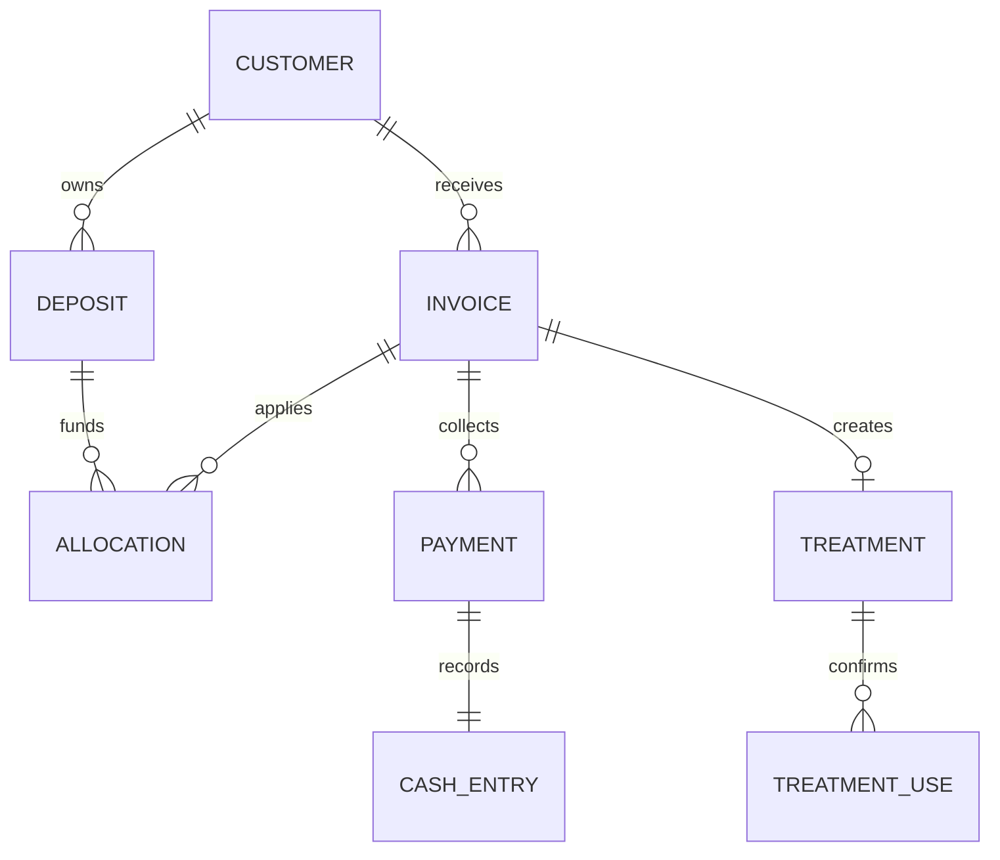

# Thiết kế chuyển đổi SpaCare

## Nhật ký dễ đọc - 21/10/2026
Theo yêu cầu người dùng: nhật ký OWNER hiển thị nhãn thao tác tiếng Việt, tiền VND, giờ Việt Nam, lý do và thay đổi trước → sau khi bản ghi có snapshot. Bản ghi cũ không có snapshot không suy đoán giá trị trước. Tên tham chiếu lấy từ danh mục hiện tại kèm mã ngắn; tham chiếu không tải được giữ mã để đối chiếu. Chỉ trình bày các trường nghiệp vụ cho phép, không hiển thị JSON, mật khẩu, digest hoặc nét ký. Có tìm kiếm, lọc ngày/người/thao tác và phân trang trong tối đa 500 bản ghi API đã trả. Không đổi API, schema, phân quyền hoặc dữ liệu audit gốc; không ghi mutation khi xem nhật ký.

## Sửa lỗi hiển thị và điều hướng — 21/10/2026

- Bộ lọc danh sách lưu tại query parameter `search`. Mở hóa đơn sau hoàn thành lịch, bấm mã HĐ hoặc mã lịch đều mang mã đầy đủ sang URL đích. Workspace đọc trực tiếp URL, không truyền bộ lọc qua ref của trang cũ; reload và Back/Forward giữ bộ lọc. Nhập tìm kiếm dùng History replaceState được Next.js đồng bộ để không tạo một mục lịch sử cho mỗi ký tự. Điều hướng chỉ đọc dữ liệu đã được API phân quyền, không gọi mutation.
- Chỉ số STAFF giữ điều kiện CONFIRMED và chỉ lịch được phân công cho user hiện tại. Ngày bắt đầu lịch được chuyển bằng `spaDay` theo UTC+7 (Asia/Ho_Chi_Minh) trước khi so với ngày spa; không cắt ngày từ chuỗi UTC. OWNER/thu ngân giữ chỉ số tổng hợp hiện có. Danh sách STAFF vẫn nằm trong cửa sổ tối đa 500 lịch do API trả về; thay đổi này không mở rộng truy vấn hay quyền dữ liệu.
- Trang gốc bọc Workspace trong Suspense để hỗ trợ useSearchParams khi prerender. Không thay schema, API ghi, transaction, idempotency hay audit; các nghiệp vụ OPEN giữ nguyên.

Nguồn: `BRD_SpaCare_v1_1.md` và `README.md` người dùng cung cấp ngày 19/10/2026. Giữ phân biệt nghiệp vụ được spa xác nhận, thiết kế đề xuất và các câu hỏi còn mở.

## Quy tắc được xác nhận và cách chuyển

| BRD | Nội dung | Cách thực hiện trong source |
|---|---|---|
| C01 | Ghi sổ, cuối ngày đưa Excel | Sổ điện tử + chốt ngày; chưa xuất Excel |
| C02 | Không hoàn cọc thông thường; có thể chuyển dịch vụ khi hợp lý | Không tự hoàn; Owner phê duyệt từng phân bổ theo giả định thận trọng |
| C03 | Dư cọc giữ lần sau | `Deposit.balance`; phân bổ không tạo CashEntry |
| C04 | Phiếu liệu trình ký mỗi buổi | Mã tham chiếu phiếu ký; chưa thu chữ ký số |
| C05 | Dừng liệu trình không tự hoàn | Chưa có action kết thúc/bảo lưu, chờ chốt chính sách |
| C06 | Khách nợ và trả sau | `Invoice.total - Invoice.paid`; mỗi lần thu có Payment |
| C07 | Chỉ chủ spa chỉnh khoản đã ghi | STAFF thu ngân chỉ ghi mới; Owner đảo sai sót + audit |
| C08 | Xác nhận thay thế có lý do | Ghi phương thức, lý do, tham chiếu, người ghi, snapshot/digest |
| C09 | Bán gói nhiều buổi, nhận cọc thường xuyên | Treatment gắn Invoice, phân bổ cọc vào Invoice |

## Quyết định kỹ thuật đang áp dụng trong MVP

Các mục này là thiết kế, không được coi là đã có xác nhận bổ sung của spa:

- OWNER duyệt mọi phân bổ cọc (hiện tại). Xác nhận 21/10/2026 (BR-ACCESS-002): nhân viên trực tiếp phục vụ sẽ được xác nhận tiền thực nhận và phân bổ cọc; có code mới. STAFF có `cashier=true` được ghi tiền (giữ nguyên cho các hành động khác). Xác nhận 21/10/2026 (BR-ACCESS-001): STAFF truy cập tab Hóa đơn, Tiền cọc và Sổ thu chi; chưa có code. STAFF thường được quản lý khách, đặt lịch, ghi buổi và kết thúc lịch của mình.
- Tiền nguyên VNĐ thay cho NUMERIC(18,2), tối đa 1.000 tỷ mỗi khoản. Nếu nhập từ SQL có phần lẻ phải xử lý riêng, không tự làm tròn.
- Bản ghi xác nhận append-only qua API hiện tại. Chưa có quy trình sửa/xóa xác nhận, nên không cung cấp nút sửa số buổi lịch sử.
- Ngày chốt là ngày Việt Nam UTC+7. Tiền đầu ngày nhập tay; chỉ mở sổ ngày hiện tại.
- Giao dịch sai được đảo bằng bút toán đối ứng ngày hiện tại. Không cập nhật trực tiếp tiền gốc; cờ `reversed` là projection trạng thái, lịch sử nằm ở CashEntry/Allocation/Audit.
- Chốt sổ phản ánh dòng tiền, không lấy tổng hóa đơn; không tự cân chênh lệch.
- Serialize mutations theo spa bằng Control document trong transaction. Cách đơn giản này ưu tiên tính nhất quán cho spa nhỏ; spa lớn cần khóa theo tài nguyên hoặc ngày sau khi đo tải.
- Route Handlers chạy Node.js; không dùng Edge runtime cho kết nối Mongoose.

## Collections và quan hệ

| Collection/model | Trường trọng tâm | Liên kết / index |
|---|---|---|
| Spa | name, timezone | Đơn vị sở hữu |
| User | spaId, name, email, role, cashier, passwordHash | email unique toàn hệ thống |
| Session | spaId, userId, tokenHash, expiresAt | tokenHash unique, TTL |
| Control | spaId, revision | spaId unique, write guard |
| Customer | spaId, name, phone, notes | spaId + phone, không unique vì BRD còn mở |
| Service | spaId, name, price, duration | Thời lượng phút |
| Appointment | customerId, serviceId, staffId, startAt, endAt, status | spaId + staffId + startAt + endAt |
| Invoice | customerId, serviceId, description, total, paid, dueDate | Snapshot tên và giá khi tạo |
| Deposit | customerId, amount, balance, receiptId | Tiền cọc đã thực nhận |
| Allocation | depositId, invoiceId, amount, approvedBy, reason, reversed | Không tạo dòng tiền mới |
| Payment | invoiceId, amount, receiptId, reversed | Lần thu hóa đơn |
| CashEntry | direction, method, kind, day, amount, originalId | Index theo spa/ngày/phương thức; originalId unique khi có |
| Treatment | customerId, invoiceId, totalSessions, remaining | spaId + invoiceId unique |
| TreatmentUse | treatmentId, method, reason, evidenceReference, snapshot, digest | Không có API UPDATE/DELETE |
| Day | day, opening, expected, counted, difference, status | spaId + day unique |
| Audit | actorId, action, targetId, details | Lịch sử sự kiện và snapshot chốt/mở lại |
| Idempotency | userId, key, fingerprint, result | spaId + key unique |
| Migration | version, appliedAt | version unique |

Mongoose tự đặt tên collection ở số nhiều. Mọi tham chiếu được service tìm với `spaId`; MongoDB không có foreign key nên không được ghi trực tiếp bỏ qua service.

## Tính nhất quán

Mọi mutation chạy trong transaction: tăng revision Control, nạp lại quyền user, kiểm tra idempotency, kiểm tra tham chiếu và bất biến, ghi dữ liệu cùng audit/idempotency, commit majority. Mongoose retry các transient transaction conflicts. Không Promise.all các ghi trong cùng transaction.

Tiền cọc và `Invoice.paid` là projection được cập nhật cùng sự kiện. Tổng `paid` không âm/vượt tổng hóa đơn, phân bổ không vượt số dư cọc, một khoản chỉ đảo một lần. `Treatment.remaining` chỉ giảm cùng bản ghi Use đã có xác nhận. Lịch dùng khoảng nửa mở `[startAt,endAt)`, không trùng cùng nhân viên.

## Những câu hỏi còn mở được giữ từ BRD

1. Nhân viên có được lập hóa đơn dịch vụ không gắn với lịch hẹn không (BR-OPEN-001: OPEN).
2. Thời hạn gói (mặt 1–2 năm, triệt lông 2–5 năm) và bảo lưu nếu có lý do hợp lý; còn mở thời hạn cụ thể từng gói, tiêu chí lý do hợp lý và người duyệt (BR-OPEN-002: PARTIALLY ANSWERED).
3. Xác nhận buổi liệu trình: nhân viên cho khách xác nhận trên app; còn mở phương án thay thế khi không thể xác nhận trên app, chưa được tự kết luận ảnh chụp gửi nhóm chat là đủ (BR-OPEN-003: PARTIALLY ANSWERED).
4. Ngoại lệ hoàn tiền khi spa hủy dịch vụ hoặc không thể tiếp tục cung cấp (BR-OPEN-004: OPEN).
5. Sửa khoản thu chi đã ghi: chỉ chủ spa được sửa; còn mở quy trình mở lại hoặc xử lý khoản ghi nhầm đã chốt sổ (BR-OPEN-005: PARTIALLY ANSWERED).
6. Cách ghi nhận doanh thu gói và doanh thu dịch vụ; phân biệt dòng tiền thực thu và doanh thu kế toán (BR-OPEN-006: OPEN).
7. Dịch vụ triệt lông tính theo buổi hay theo liệu trình (BR-OPEN-007: OPEN).
8. Khách dừng gói không hoàn tiền hoặc đổi sang dịch vụ có giá trị tương đương; còn mở cách tính giá trị phần gói chưa sử dụng và người duyệt (BR-OPEN-008: PARTIALLY ANSWERED).
9. Thời hạn gói bắt đầu tính từ ngày mua hay ngày sử dụng đầu tiên (BR-OPEN-009: OPEN).
10. Khách dùng gói trước và thanh toán trong khoảng 1–2 tuần; còn mở số ngày chính xác và mốc bắt đầu tính thời hạn thanh toán (BR-OPEN-010: PARTIALLY ANSWERED).
11. Công thức tính tiền hoa hồng và thời điểm ghi nhận (BR-OPEN-011: OPEN).
12. Quyền của cấp quản lý xem lương và hoa hồng của nhân viên khác (BR-OPEN-012: OPEN).
13. Quy chế tính lương nhân sự và chu kỳ chốt bảng lương (BR-OPEN-013: OPEN).

## Thay Flyway và dữ liệu cũ

`db:setup` là migration MongoDB phiên bản 1: tạo collections và indexes, seed owner nếu email chưa có, ghi Migration.version=1. Chạy lại không đặt lại mật khẩu. Không sửa hoặc chạy SQL V1/V2 trên MongoDB.

Chưa có dữ liệu/schema SQL V1 trong đầu vào nên chưa viết import giả định. Khi có export cũ cần: backup, mapping ID SQL sang ObjectId, giữ legacyId, đối chiếu tổng cọc/công nợ/thu chi/lượt dùng và UNVERIFIED, giữ bản ghi chưa xác minh, dry-run rồi mới chuyển thật. Không mặc định xác nhận dữ liệu liệu trình cũ.

## Cập nhật 20/10/2026

Đọc `BRD.md`, `BUSINESS_RULES.md`, `DATA_MODEL.md` để theo dõi quy tắc và schemas hiện tại. Yêu cầu người dùng mới đã chốt cần kiểm tra trùng email/SĐT, thay cho mục trùng SĐT còn mở trong bản thiết kế ban đầu. Index SĐT vẫn không unique; operations chuẩn hóa và kiểm tra trong transaction. Đã bổ sung sửa khách/dịch vụ/STAFF và ngừng/mở lại dịch vụ/STAFF; xóa mềm là thiết kế đề xuất đang áp dụng.

## Cập nhật 21/10/2026

Xác nhận phân quyền giao diện (BR-ACCESS-001): STAFF truy cập tab Hóa đơn & công nợ, Tiền cọc và Sổ thu chi; code hiện tại hạn chế các tab này cho finance/cashier, cần cập nhật. Xác nhận nhân viên phục vụ được thu tiền và phân bổ cọc (BR-ACCESS-002): thiết kế kỹ thuật PROPOSED, chưa có code. Bán gói một luồng là nhu cầu CONFIRMED chưa có code (BR-PKG-001). Bổ sung chính sách: thanh toán 1-2 tuần (BR-PKG-002), thời hạn gói theo loại dịch vụ (BR-PKG-003), bảo lưu tùy trường hợp (BR-PKG-004), dừng gói có thể đổi dịch vụ tương đương (BR-TRT-002). Xếp lại lịch hoãn bằng lịch mới xung đột với reschedule-on-same-record hiện tại (BR-TECH-008); cần xét lại code. Rà soát và đồng bộ các câu hỏi mở BR-OPEN-001 đến BR-OPEN-010: phân biệt rõ nội dung đã biết và nội dung còn mở; xác nhận buổi thực hiện trên app và không tự kết luận ảnh chụp nhóm chat là đủ (BR-OPEN-003); giữ nguyên trạng thái OPEN cho các nội dung chưa được chốt.

Thiết kế menu phân cấp (BR-ACCESS-001):
- Tái cấu trúc menu sang dạng phân cấp có khả năng thu gọn/mở rộng:
  - **Tổng quan** (`overview`)
  - **Vận hành**: Lịch hẹn (`appointments`), Khách hàng (`customers`)
  - **Dịch vụ & liệu trình**: Danh mục dịch vụ (`services`), Gói liệu trình (`packages`), Buổi đã sử dụng (`treatment_uses`)
  - **Tài chính**: Hóa đơn & công nợ (`invoices`), Tiền cọc (`deposits`), Sổ thu chi (`cash`), Chốt sổ ngày (`days`), Thống kê dòng tiền (`reports`)
  - **Quản trị**: Nhóm Nhân viên [Danh sách nhân viên (`staff`), Lương (`salary`), Hoa hồng (`commission`)], Nhật ký thao tác (`audit`)
- Mỗi mục con mở một trang riêng biệt, không cuộn gộp trên trang dài.
- Trang Lương và Hoa hồng được phân quyền xem: Nhân viên chỉ xem của chính mình, Chủ spa xem toàn bộ. Công thức tính hoa hồng và quyền quản lý xem nhân viên khác được đánh dấu rõ ràng là OPEN (BR-OPEN-011, BR-OPEN-012, BR-OPEN-013). Hệ thống ghi nhận sản lượng thực tế (ca làm, buổi ghi) mà không tự ý tính toán tiền hoa hồng giả định.

## Cập nhật ưu tiên theo yêu cầu mới nhất — 21/10/2026

Menu phân cấp có thể thu gọn/mở rộng, dùng chung cấu hình cây trên desktop và mobile. Tổng quan tại `/`; mỗi mục hoạt động mở trang riêng `/workspace/{section}`, hỗ trợ tải lại và Back/Forward. Server kiểm tra phiên và quyền: services/staff/audit chỉ OWNER, days/reports OWNER hoặc thu ngân. Không thay đổi quyền ghi tài chính hay phạm vi dữ liệu API workspace.

Yêu cầu này thay thế mô tả trước về trang Lương/Hoa hồng hiển thị sản lượng: chỉ tạo trang hoạt động khi nghiệp vụ được xác định. Hiện hai mục chỉ ghi “Chưa triển khai”, không liên kết, không có trang hoạt động, schema hoặc API lương/hoa hồng. Không tạo kỳ lương giả hay suy ra hoa hồng từ người ghi buổi. Khi triển khai: backend lấy spaId/actorId từ phiên, STAFF chỉ xem của mình, OWNER xem toàn spa. BR-OPEN-011 (công thức/thời điểm hoa hồng), BR-OPEN-012 (quyền quản lý xem nhân viên khác), BR-OPEN-013 (quy chế và kỳ lương) giữ OPEN. Cấu hình route là thiết kế kỹ thuật; không chốt thêm chính sách tài chính.

## Quyết định triển khai luồng — 21/10/2026
Theo yêu cầu mới nhất: triển khai sellPackage, thu tiền/phân bổ cọc cho nhân viên phục vụ và tạo lịch mới khi xếp lại POSTPONED. Các mục kế hoạch/chưa có code trước đó cho các luồng này đã được thay thế; đọc BUSINESS_RULES, DATA_MODEL và API cập nhật.
CONFIRMED: lịch cũ được giữ; bán gói một thao tác; dùng gói còn nợ trong hạn đã chọn; xác nhận tiền thực nhận và tham chiếu ảnh chuyển khoản gửi nhóm; phân bổ cọc giữ số dư.
PROPOSED kỹ thuật đang áp dụng: liên kết lịch kế tiếp bằng rescheduledFromId cùng unique index; STAFF chỉ payment/allocate hóa đơn trực tiếp hoặc gói có lịch CONFIRMED/COMPLETED được giao; hạn thanh toán chọn tường minh trên Invoice; schema/action như API cập nhật. Mọi mutation tuần tự trong transaction, bảo vệ Control theo spa, quyền user được nạp lại, audit và idempotency commit cùng dữ liệu.
OPEN: chế tài quá hạn, chuẩn số ngày và mốc tính hạn; giá trị buổi còn lại khi đổi gói; quy trình/tiêu chí bảo lưu. Không suy ra hoàn tiền, quy đổi buổi hay tự khóa gói. Không giả định tham chiếu ảnh ngân hàng là phương thức xác nhận buổi liệu trình được spa duyệt; BR-OPEN-003 vẫn giữ.

## Thiết kế ghi buổi ký trực tiếp — 21/10/2026
Theo xác nhận mới nhất: thay form chọn phương thức/tham chiếu bằng thông tin khách/gói/người thực hiện/buổi và ô ký tay/chuột. Khách có lịch thực hiện tại Lịch hẹn; không lịch thực hiện trên Gói. Ký lại xóa nét, Hủy không lưu; submit khóa khi chữ ký trống/đang gửi. SVG chỉ render polyline từ tọa độ hữu hạn, không chèn markup từ dữ liệu. Dùng Pointer Events + pointer capture và touch-action:none riêng khung ký; nét lưu tọa độ chuẩn hóa để xem trên nhiều kích thước.
Backend ràng buộc chữ ký với snapshot buổi và remainingBefore trong transaction. Dữ liệu thay đổi khi đang ký trả409, không tự áp chữ ký cũ cho buổi tiếp theo. Chuỗi lịch/gói/khách được kiểm tra cùng spa; không thay quyền thanh toán hoặc thu ngân. Chữ ký đầy đủ tải riêng khi người có quyền mở xem; list và audit không chứa nét ký. Không dùng ảnh ký mẫu/giả cho bản ghi lịch sử.
Bảo lưu: ACTIVE -> PAUSED -> ACTIVE bằng action OWNER, lưu before/after/lý do trong audit, không đổi remaining. Không scheduler tự mở lại, không kéo hạn dùng theo holdUntil. expiresOn là ngày OWNER nhập tường minh khi duyệt gia hạn lúc mở lại, không suy ra hạn gốc hoặc chính sách quá hạn.

## Khôi phục kết nối MongoDB - 21/10/2026

Thiết kế kỹ thuật PROPOSED: chỉ chia sẻ promise đang kết nối; xóa promise khi hoàn tất hoặc thất bại. Sau mất kết nối, lần gọi tiếp theo phải kết nối lại thay vì nhận promise thành công cũ. Log lỗi kết nối chỉ chứa mã phân loại cố định, không chứa thông báo driver có thể mang bí mật. Kiểm tra session cookie trước DB để người chưa đăng nhập vẫn nhận 401 khi DB không sẵn sàng.

## Đồng bộ điều hướng điện thoại - 22/10/2026

Theo yêu cầu người dùng: thanh dưới điện thoại lấy trực tiếp 5 nhóm cấp đầu của menu chung, cùng tên và thứ tự với menu phía trên/desktop. Nhóm mở bảng mục con nổi, không đẩy nội dung trang xuống; Tổng quan mở trang gốc. Mục con giữ kiểm tra canViewPage và mục chưa triển khai giữ trạng thái không bấm được. Đường dẫn nhóm hiện tại suy ra từ cây menu, không duy trì bảng ánh xạ riêng. Chọn mục đóng bảng; hỗ trợ đóng bằng nút, nền ngoài và Escape. Đây là thay đổi trình bày, không đổi API, schema hoặc quyền nghiệp vụ.

## Danh sách và bộ chọn khách hàng lớn - 22/10/2026

Trang Khách hàng tìm và phân trang tại backend, không lọc chỉ trong preview workspace. Bộ chọn khách trong form tìm backend, 20 kết quả mỗi trang, giữ khách đã chọn khi tìm/trang thay đổi; request cũ được hủy để tránh ghi đè kết quả mới. Sửa/thêm khách reload dữ liệu và trang khách. Các bản ghi workspace có tham chiếu khách ngoài preview được nạp đúng tên/điện thoại theo cùng spa. Chưa đổi cơ chế tải 500 của danh sách khác hoặc báo cáo khoảng ngày.

## Phân trang toàn bộ workspace - 22/10/2026

Thay thế cửa sổ dữ liệu cũ: mỗi trang danh sách gọi workspace với section, search, page, pageSize. Tìm kiếm/đếm trước khi cắt trang. Cọc và lịch sử phân bổ đổi trang độc lập. Audit lọc ngày/người/thao tác tại backend. Khi đổi bộ lọc, về trang đầu; response cũ không ghi đè request mới hoặc trang sau điều hướng. Bảng giữ phân trang local cho phần xem nhanh Tổng quan; các danh sách lịch sử dùng metadata backend. Danh mục và lựa chọn nghiệp vụ còn dùng được tải riêng với dữ liệu tham chiếu của trang, giúp lịch sử cũ hiển thị đúng tên. Xóa dòng giới hạn bản ghi trên footer, gói và nhật ký. Báo cáo dùng DB aggregate; không cộng các dòng của một trang.

## Rút gọn chữ trên điện thoại - 22/10/2026

Theo yêu cầu người dùng: gom nút menu biểu tượng vào một hàng cùng thương hiệu/tài khoản; chỉ giữ một H1 của trang. Trên mobile ẩn breadcrumb, eyebrow, mô tả trang, vai trò lặp trong header, footer và tiêu đề panel đầu khi trùng ngữ nghĩa với H1. Tổng quan bỏ phần khẩu hiệu trên mobile, giữ nút đặt lịch và số liệu; tiêu đề các phần khác nhau như lịch gần nhất/biểu đồ/lịch sử phân bổ vẫn giữ. Không ẩn lưu ý nghiệp vụ, lỗi, trạng thái hoặc nội dung xác nhận thanh toán/chữ ký. Desktop giữ cách trình bày hiện có.

### Tìm và chọn khách trong biểu mẫu
- Nhãn tìm khách được in đậm. Kết quả tên và số điện thoại hiển thị ngay dưới ô tìm kiếm dưới dạng danh sách chọn, không cần mở dropdown thứ hai.
- Danh sách có vùng cuộn và phân trang máy chủ, giữ khách đã chọn khi đổi từ khóa hoặc trang; áp dụng cho đặt lịch và các biểu mẫu dùng chung bộ chọn khách.

## Bán gói và hóa đơn — 22/10/2026
- Danh mục liệu trình tách khỏi Gói của khách: OWNER nhập mẫu, nhân viên có quyền bán chọn khách/mẫu/giá/hạn trả, thêm nhiều Quà tặng0đ và tên đợt khuyến mãi.
- Tư vấn mặc định tại form khách; form bán/hóa đơn có lựa chọn thay thế. Danh mục dịch vụ có mức hoa hồng tiền cố định, chưa hiển thị bảng tính trả hoa hồng.
- Tạo hóa đơn: tìm khách, chọn dịch vụ, sửa nội dung/giá; nếu chọn gói khả dụng của khách thì giá khóa0 và yêu cầu ký trước khi lưu. Không bấm thu tiền cho hóa đơn0.
- Hóa đơn có người tạo, nút Chi tiết/chữ ký; chi tiết hiện chữ ký trực tiếp khi được phép, quà tặng và lịch sử. Khách hàng có nút Lịch sử phân trang, mở từng hóa đơn. Menu nhật ký thao tác/buổi sử dụng được ẩn; routes cũ giữ để không phá tham chiếu lịch sử.
- Hoàn thành buổi gói từ lịch hoặc gói mở ngay hóa đơn mới0đ. Hủy ký không ghi/trừ buổi. Không tạo chữ ký/người tạo giả cho dữ liệu cũ.

Lịch sử khách có bộ chọn Hóa đơn và buổi đã thực hiện / Lịch hẹn / Gói đã mua hoặc được tặng; từng loại phân trang độc lập. Hoàn thành lịch lẻ cho người có quyền tài chính sửa nội dung/giá hóa đơn mới ngay trước khi xác nhận.

Chữ ký trong chi tiết hóa đơn: hiển thị ngay hình ký theo từng buổi, ngày thực hiện và tên gói. Hóa đơn mua gói có cả buổi của quà tặng kèm, phân trang5. Hóa đơn/lượt cũ có chữ ký đã lưu được tra qua liên kết gói/lịch, không cần tạo lại hóa đơn. Khi không có chữ ký được phép xem phải hiện trạng thái rõ ràng thay vì ẩn cả mục.

## Thu ngân tham khảo EasySalon — 22/10/2026
- Tham khảo bố cục danh mục cạnh hóa đơn, ô tìm kiếm và chuyển loại dịch vụ/gói đã quan sát trên EasySalon. Dùng màu và thành phần SpaCare, không sao chép dữ liệu tài khoản tham khảo.
- Ba phần: Khách hàng (tìm tên/SĐT phân trang, thêm khách và tự chọn khách vừa tạo); danh mục thẻ (Dịch vụ lẻ/Bán gói/Dùng liệu trình, tìm không dấu, phân trang8); hóa đơn xem trước và tổng tiền.
- Desktop danh mục/hóa đơn cạnh nhau, hóa đơn sticky; tablet/điện thoại xếp dọc, thẻ2 cột. Không có thanh tìm trùng ở header trang này. Đổi khách/loại/xóa lựa chọn xóa chữ ký cũ và lựa chọn liên quan.
- Bán gói có nhiều quà tặng0đ và tên đợt; dùng gói chỉ hiện ACTIVE/còn buổi của khách đã chọn, giá0 và yêu cầu chữ ký. Backend tiếp tục xác minh mọi điều kiện khi lưu.
- Lưu xong mở Chi tiết hóa đơn để xem chữ ký và chọn Thu tiền mặt/Chuyển khoản; form payment xác nhận thực nhận vẫn dùng chung. Reset bản soạn sau khi lưu thành công; lỗi giữ nội dung để sửa/retry. Chọn danh mục không tạo nháp DB.
- Nút Tạo hóa đơn ở danh sách và Bán gói ở gói khách cùng dẫn về Thu ngân; lịch sử/hóa đơn cũ giữ cách truy cập cũ. Không bổ sung giỏ nhiều dịch vụ/sản phẩm hay chính sách tài chính từ EasySalon.

## Các màn tham khảo EasySalon — 22/10/2026
- Thanh bộ lọc chung cho lịch, hóa đơn, cọc, gói, dịch vụ, nhân viên, thu chi/chốt sổ. Bộ lọc lưu URL để tải lại/Back giữ lựa chọn; đổi bộ lọc về trang1. Tìm kiếm vẫn riêng và áp dụng cùng bộ lọc tại backend.
- Lịch: Hôm nay/7 ngày tới/khoảng ngày, chọn trạng thái/nhân viên. Danh sách giữ đầy đủ dời/hoãn/hủy; Lịch theo ngày là agenda phân trang, có giờ/khách/dịch vụ/nhân viên và hoàn thành. Không hứa lịch đã tải đủ toàn bộ ngày khi còn trang khác.
- Khách: cột lần đến/lịch tới theo quyền; hồ sơ có ghi chú/tư vấn/tổng hợp trong phạm vi, ba tab Hóa đơn-chữ ký/Lịch hẹn/Liệu trình. Nút đặt lịch điền sẵn khách; nút thu ngân chọn sẵn khách (chỉ tài chính).
- Dịch vụ: nhập nhóm, lọc nhóm/trạng thái; nhóm gói kế thừa dịch vụ và chọn được ở Thu ngân. Không tự gán nhóm cho dữ liệu cũ.
- Thu chi: mã phiếu/người tạo, chọn tiền mặt/ngân hàng/thu-chi/ngày/nhân viên; ba số thu/chi/chênh lệch tính cả tập lọc. Giữ lưu ý về cọc/thanh toán và đảo sai sót.
- Nhân viên: lọc trạng thái, bấm tên mở hồ sơ sản lượng và xem lịch được giao; giữ sửa/khóa theo OWNER. Không có bảng lương giả.
- Kiểm tra trực quan bằng SSR component thực + dữ liệu minh họa, CSS mobile, không tràn ngang ở viewport thực tế502px. Đây là kiểm tra bố cục tĩnh, không thay kiểm thử tương tác hay database trên ứng dụng đang chạy.

## Giao diện Lương / Hoa hồng — 22/10/2026
Mở hai mục trong Quản trị > Nhân viên, bỏ trạng thái chưa triển khai. STAFF chỉ đọc của mình, OWNER có chọn nhân viên và tháng.
Lương: cấu hình lương từng người; lập nháp tháng với cơ bản/thưởng/khấu trừ/lý do; xem phân rã, số buổi và khoản tồn trước tháng; duyệt; ghi nhận chi qua tiền mặt/chuyển khoản có checkbox thực chi. Bảng duyệt/chi không có sửa/xóa. Danh sách phân trang10. Cài lương không đồng nghĩa đã chi; duyệt không tạo phiếu chi.
Hoa hồng: tổng tiền/số ca-buổi/thành phần chưa chốt, từng dòng dịch vụ/người làm/ngày/nguồn và trạng thái vào bảng/đã chi. Không lấy doanh thu khách trả làm hoa hồng.
Hóa đơn lẻ không lịch có nút Hoàn thành dịch vụ / ghi hoa hồng, chọn người trực tiếp làm; tạo hóa đơn hoặc bán gói chưa ghi Commission. Buổi gói không lịch cho người có quyền chọn nhân viên trước ký; đổi người xóa chữ ký. Có lịch giữ người của lịch.
Các phiếu chi PAYROLL hiển thị Chi lương và không có Đảo sai sót thông thường. Không có chuyển tiền thật hoặc tài khoản ngân hàng nhân viên trong MVP này.

## Cài hoa hồng theo dịch vụ — 22/10/2026
Trang Hoa hồng của OWNER có vùng Hoa hồng theo dịch vụ, nút ＋ Tạo hoa hồng mở chọn dịch vụ + tiền cố định mỗi lần. Danh sách tìm theo tên, phân trang10, Sửa hoa hồng từng dịch vụ; dịch vụ ngừng có nhãn. Chưa có dịch vụ dẫn sang Thêm dịch vụ. STAFF chỉ xem khoản hưởng, không có cấu hình.

## Lịch hẹn ngang và giờ hoạt động - 23/10/2026
CONFIRMED theo yêu cầu người dùng: giờ vận hành 09:00–22:00 Asia/Ho_Chi_Minh. Public booking tạo mốc bắt đầu mỗi 30 phút, lọc theo duration để endAt không vượt 22:00. Backend áp dụng cùng kiểm tra cho appointment, rescheduleAppointment và POST /api/booking. Lịch theo ngày trình bày trục ngang chia theo nhân viên; lịch cũ ngoài giờ vẫn hiện với viền cảnh báo. Đây là giờ hoạt động nghiệp vụ, không thay đổi schema.

## Đặt lịch web và cạnh tranh khung giờ - 23/10/2026
Frontend giữ UUID cho cùng nội dung khi retry, tạo UUID mới nếu nội dung đổi, gửi thời gian theo +07:00 và bỏ số điện thoại giả. Khi backend trả 409, hiển thị thông báo trong role=alert, giữ form để khách chọn giờ khác. Backend kiểm tra overlap bằng startAt < end mới và endAt > start mới, chỉ CONFIRMED, chung Control guard với operations để tránh race. Không trả chi tiết lịch của người khác.

## Đơn giản phiếu kho - 23/10/2026
Nhập/xuất từ thẻ sản phẩm: tiêu đề ghi tên sản phẩm, mô tả có SKU/tồn hiện tại; productId giữ trong defaults, form chỉ nhập số lượng và không hiển thị lý do. Nút nhập/xuất chung vẫn có bộ chọn sản phẩm.

## Ảnh và danh mục sản phẩm công khai - 23/10/2026
Form sản phẩm dùng bộ chọn ảnh với nút Chọn ảnh/Chụp ảnh, preview và Bỏ ảnh. Khóa nút lưu trong lúc tải; lỗi tải giữ ảnh cũ và hiển thị thông báo. Ảnh tối đa 5 MB; HEIC hiển thị hướng dẫn đổi JPG. Menu desktop/mobile/footer có Sản phẩm; danh mục công khai dạng thẻ 3 cột desktop, 2 cột tablet, 1 cột điện thoại, ảnh lazy load, tìm kiếm và phân trang. Không hiển thị dữ liệu kho chính xác cho khách.

## Giao diện dùng chung - 23/10/2026
Theo yêu cầu người dùng: ngoài và trong dùng cùng bộ màu, font, nút, ô nhập và thẻ nội dung trong ui.css. Brand dùng chung cho trang công khai, quản lý và đăng nhập/đăng ký; menu công khai dùng một cấu hình cho desktop/mobile; ServiceCard dùng chung trang chủ và danh mục. Trang chủ rút gọn thành giới thiệu, dịch vụ, sản phẩm qua liên kết và thông tin spa; footer liên hệ gọn, giờ 09:00–22:00. Không đổi route công khai, quyền, dữ liệu hoặc luồng nghiệp vụ; /workspace vẫn là tổng quan quản lý và / là trang chủ công khai.

## Báo cáo và nhân viên — 23/10/2026
PROPOSED kỹ thuật theo yêu cầu tiếp tục: báo cáo tách giá trị hóa đơn (ngày tạo, thanh toán hiện tại), thu chi (ngày ghi sổ), kết quả nhân viên (ngày phát sinh). Không chốt doanh thu kế toán BR-OPEN-006. OWNER xem nhân viên; OWNER/thu ngân xem báo cáo tài chính. Tổng hợp toàn bộ bộ lọc cùng spa trước phân trang; CSV chỉ xuất tổng hợp.
GET /api/payroll view=salary thêm salarySummary: [{_id: DRAFT|APPROVED|PAID, count, total}] theo tháng/nhân viên trên toàn bộ dữ liệu. STAFF chỉ xem mình; danh sách nhân sự không gồm CUSTOMER. Không thay schema hoặc action chi lương. Buổi thiếu staffId không suy người thực hiện từ actorId. UI chung thẻ tổng hợp và liên kết Nhân viên/Bảng lương/Hoa hồng, thẻ mobile hai cột. Hai URL EasySalon chưa truy cập được trong phiên này.

## BR-LEAVE-001 — Thống kê nghỉ — 23/10/2026
CONFIRMED: nghỉ có phép/không phép chỉ để thống kê, chủ spa quyết định khi chốt lương; không tự động khấu trừ, thay lương hoặc hủy lịch. PROPOSED kỹ thuật: OWNER ghi/sửa ngày nghỉ; STAFF xem chính mình. Một ngày nguyên/người, chưa suy chính sách nửa ngày hay quy trình xin phép.
StaffLeave: spaId, staffId, staffName snapshot, day YYYY-MM-DD, type PERMITTED|UNPERMITTED, note, actorId, timestamps. Unique (spaId,staffId,day), index (spaId,day desc). Không xóa lịch sử audit.
POST /api/operations action recordStaffLeave {staffId,day,type,note?}: OWNER, cùng spa, nhân sự OWNER/STAFF; upsert theo người/ngày trong transaction guard có idempotency và audit before/after. Không ghi tài chính. GET /api/payroll view=salary thêm leaves (10/trang), leavePage, leaveTotal, leaveSummary [{_id:{staffId,type},count}], lọc tháng/nhân viên và phạm vi phiên trước tổng hợp/phân trang. UI trong Lương thống kê toàn tháng, danh sách ngày và nút ghi/sửa dành OWNER.

## Cập nhật ưu tiên mới nhất — 23/10/2026: nhập liệu, nghỉ và hoa hồng bán gói
Nguồn CONFIRMED: PROMPT CẬP NHẬT SPACARE trong phiên hiện tại. Thay thế BR-LEAVE-001 trước đó về chỉ thống kê: nay có duyệt, nửa ngày và cấu hình tính lương. Thay thế phạm vi cũ không có hoa hồng bán hàng bằng hoa hồng bán gói 5% trên thực thu đủ điều kiện; giữ nguyên hoa hồng thực hiện dịch vụ cố định.
CONFIRMED: OWNER duyệt và sửa bản nghỉ đã duyệt; có phép không đồng nghĩa hưởng lương; không suy ngày công từ lịch hẹn. OWNER cấu hình và chốt lương. Tiền lưu nguyên VNĐ, giao diện vi-VN. Không bắt mã sản phẩm, lý do/nội dung nhập kho; giữ dữ liệu lịch sử.
PROPOSED kỹ thuật đang áp dụng (không phải quy chế spa đã xác nhận):
- Bản nghỉ có startDay/endDay (gồm ngày cuối), period FULL/AM/PM cho mỗi ngày trong khoảng, type PERMITTED/UNPERMITTED, status PENDING/APPROVED/REJECTED, paid độc lập; reviewedBy/reviewedAt lưu lúc OWNER duyệt. STAFF gửi/sửa PENDING của mình; OWNER ghi/sửa mọi bản. Legacy thiếu status tiếp tục được xem là ngày đã ghi, paid=false, không bịa người duyệt. Không tính bản từ chối/chờ duyệt vào lương.
- Kiểm tra overlap theo ngày + sáng/chiều trong transaction Control chung. Nghỉ trùng công đã ghi bị từ chối; công không trùng nghỉ đang giữ chỗ; hai nửa khác buổi có thể cùng ngày. Công thực tế nhập bởi OWNER, không nhận ngày tương lai.
- Chính sách riêng từng người: standardDays, paidLeaveDays theo THÁNG, mode NONE hoặc DAILY. NONE/không cấu hình giữ lương tháng. DAILY yêu cầu OWNER xác nhận đủ dữ liệu công; earnedBase=round(baseSalary*min(standardDays,workdays+min(paidLeaveDays,nghỉ đã duyệt paid))/standardDays). Không tự coi thiếu lịch là nghỉ. Không tự tính OT, thuế, BHXH, phép tích lũy/năm. Giá trị 26 trong form chỉ gợi ý chưa lưu, không phải chính sách mặc định.
- Một Payroll hiện có: tổng = earnedBase + serviceCommissionTotal + saleCommissionTotal + bonus - deductions - advance; leaveDeduction chỉ là phần đã giảm trong earnedBase, không trừ lần hai. advance là khoản đã nhận do OWNER nhập, không ghi thêm dòng tiền; chưa có sổ tạm ứng riêng. Thiếu công khi DAILY trả lỗi. Lương âm bị từ chối, cần quy trình bù trừ riêng. Chốt kiểm tra fingerprint ngày nghỉ/công/chính sách và tập hoa hồng trước khi khóa. Sửa nguồn sau khi chốt không sửa bảng đã duyệt.
- Hóa đơn PACKAGE mới snapshot sellerId/sellerName tách consultant và performer. Không backfill người bán cho hóa đơn cũ. Giá đủ điều kiện là tổng giá bán sau giảm, phần đã thanh toán; cọc thực nhận sau khi phân bổ vào gói được tính một lần, không tính khi mới nhận cọc. Công thức cộng dồn floor((paid-refunded)/20), phát sinh delta nên chia đợt không sai làm tròn. Quà 0 và công nợ chưa thu không tạo hoa hồng bán.
- SaleCommission là ledger bổ sung để giữ nguyên unique index Commission dịch vụ cũ, không phải bảng lương thứ hai. Unique (spaId,sourceType,sourceId). Cùng payment/allocation/refund/reversal và idempotency/audit trong transaction. Điều chỉnh âm vào kỳ chưa chốt kế tiếp, không sửa khoản/bảng đã chi.
- refundPackage chỉ ghi hoàn ĐÃ THỰC HIỆN, OWNER xác nhận ngoại lệ và lý do. Không tự cho quyền hoàn khi khách dừng gói (BR-TRT-002 giữ), không dùng reverseCash làm hoàn tiền, không tự chuyển tiền. Cộng refunded riêng; paid giữ tổng đã thanh toán, không tái tạo công nợ từ tiền hoàn. Không tự đổi buổi/quyền lợi khi hoàn; điều kiện được hoàn và cách xử lý quyền lợi còn OPEN. REFUND không cho đảo bằng reverseCash thông thường.
- SKU cũ giữ nguyên khi sửa nếu không gửi; tạo mới sinh nội bộ SP-ObjectId, không phải trường nhân viên nhập. Phiếu kho vẫn chỉ số lượng như module đang có, chi mua hàng vẫn ghi riêng trong sổ thu chi; không thêm hoặc đổi chính sách giá nhập.
Cần xác nhận trước dùng tính lương thực tế: công chuẩn, hạn mức phép theo tháng hay năm/cộng dồn, cách làm tròn, OT/ngày lễ, quản lý sổ tạm ứng và bù trừ hoa hồng âm vượt lương; điều kiện ngoại lệ hoàn tiền/quyền lợi sau hoàn.

## Chuông và Web Push — 23/10/2026
PROPOSED kỹ thuật: component Notifications dùng chung desktop/mobile trong workspace của OWNER, 30 thông báo mới nhất và nút cấp quyền/tắt nhận trên thiết bị. Manifest standalone, biểu tượng PNG và service worker chỉ nhận push/click, không cache dữ liệu riêng. Crypto dùng Node OpenSSL theo RFC 8291/8292; outbox transaction, dispatch sau commit và scheduler Bearer tùy cấu hình. Chi tiết: PUSH_NOTIFICATIONS.md. Hotline chân trang/nút gọi đổi 0329357116.

## Nhân viên dùng số điện thoại — 23/10/2026
Form tạo/sửa nhân viên đổi Email thành Số điện thoại (tel, bắt buộc); tạo giữ họ tên/mật khẩu/quyền thu ngân. Danh sách và hồ sơ ưu tiên phone, fallback email cho dữ liệu cũ. Hai form đăng nhập đổi nhãn sang Số điện thoại hoặc email, dùng text để nhận được cả hai. login-identity.ts dùng chung chuẩn hóa và validation; backend tiếp tục giữ quyền/transaction/audit. Không tạo hệ thống tài khoản mới hay reset tài khoản cũ.

## Bỏ ô tham chiếu ảnh chuyển khoản — 23/10/2026
CONFIRMED theo yêu cầu mới nhất: bỏ trường nhập tham chiếu ảnh chuyển khoản trong form thu tiền hóa đơn; không bắt ghi chú thay thế. Quy tắc này thay yêu cầu ghi tham chiếu/ghi chú ảnh khi thu chuyển khoản trước đây. Vẫn bắt xác nhận đã kiểm tra tài khoản và thực nhận tiền, giữ quyền, trạng thái ngày, transaction, idempotency và audit. PROPOSED kỹ thuật: paymentEvidence dùng chung chỉ kiểm tra receivedConfirmation; transferReference vẫn là trường tùy chọn trong API/schema và giữ toàn bộ dữ liệu lịch sử. Không thay quy trình xác nhận buổi liệu trình/chữ ký; tham chiếu chi lương riêng không thuộc thay đổi này.

## Trạng thái sổ hôm nay và mở sổ lặp — 23/10/2026
PROPOSED kỹ thuật theo yêu cầu sửa lỗi danh sách trống nhưng mở sổ báo đã tồn tại: GET workspace thêm todayDay cho OWNER/thu ngân, query trực tiếp cùng spa/ngày Việt Nam và độc lập bộ lọc/phân trang. Trang days không áp dụng từ khóa search vì không có ô tìm kiếm; vẫn giữ lọc trạng thái/khoảng ngày. UI hiển thị rõ hôm nay chưa mở/đang mở/đã chốt; đã mở không hiện nút tạo thêm, đã chốt chỉ OWNER có Mở lại với lý do. openDay trên sổ OPEN trả sổ hiện có, không đổi tiền đầu ngày, không tạo sổ thứ hai; sổ CLOSED trả 409 và không tự mở lại. Giữ transaction, idempotency và audit snapshot thực tế. Không thay chính sách ai được mở/chốt/mở lại hoặc ghi đè dữ liệu lịch sử.

## Xuất PDF hóa đơn và hoa hồng - 23/10/2026
CONFIRMED: PDF để tải, in hoặc chia sẻ hóa đơn khách hàng và bảng kê hoa hồng theo nhân viên/tháng trên máy tính và điện thoại.
PROPOSED kỹ thuật: API chỉ đọc từ phiên active và cùng spa. OWNER xem phạm vi spa; STAFF giữ quyền đọc hóa đơn hiện có, chỉ xuất hoa hồng của mình. Không ghi tài chính hoặc xác nhận thu tiền/chi lương. Bảng kê lấy toàn bộ tháng theo giờ Việt Nam, tách dịch vụ/bán gói, giữ điều chỉnh âm.
Nút Tải PDF; sau khi tạo có Xem / In PDF và Chia sẻ PDF. Web Share chia sẻ file nếu được hỗ trợ, fallback mở PDF. Đổi bộ lọc hủy kết quả đang tạo. Canvas font thiết bị, A4 nhiều trang, lặp tiêu đề cột. PDF dạng ảnh, chưa tìm kiếm/copy chữ. Không gửi dữ liệu tới dịch vụ PDF ngoài. tests/pdf-browser-fixture.mjs dùng dữ liệu giả.

## Mẫu bill Thanh Thư Spa - 23/10/2026
Theo yêu cầu người dùng: PDF hóa đơn dạng bill dọc, đầu trang Thanh Thư Spa, địa chỉ CL12 Đầm Lau, xã Phụng Công, tỉnh Hưng Yên; hotline giữ 0329 357 116. Có thông tin khách, dịch vụ/quà tặng, tổng/đã trả/còn nợ, vùng khách ký và người lập, lời cảm ơn. Không tự thêm VAT, giảm giá hay xác nhận đã thanh toán. Vùng ký giấy không thay chữ ký điện tử đã lưu. Bảng kê hoa hồng giữ bố cục riêng.

## Liệu trình theo số buổi hoặc thời gian — 23/10/2026
CONFIRMED theo yêu cầu mới nhất: danh mục có hai loại lựa chọn: SESSIONS nhập số buổi, TIME nhập thời hạn và không giới hạn số lần làm (ví dụ triệt 24/36 tháng). Thay thế phần chỉ hỗ trợ số buổi trước đây và chốt BR-OPEN-007 trong phạm vi này. Cả hai loại vẫn ký, ghi lịch sử từng lần, hóa đơn buổi 0đ và hoa hồng thực hiện theo quy tắc hiện có; tài chính mua gói vẫn riêng.
PROPOSED kỹ thuật: PackageTemplate/Treatment bổ sung packageType, durationMonths (1–120); TIME không lưu totalSessions/remaining, Treatment snapshot startsOn/expiresOn YYYY-MM-DD và usedSessions. Mặc định dữ liệu cũ thiếu packageType là SESSIONS, không backfill hay thay quyền lợi gói đã bán. Mốc từ ngày mua hay lần đầu vẫn OPEN: khi bán TIME (kể cả quà) phải chọn startsOn theo thỏa thuận, không tự mặc định. Hạn tính cộng tháng lịch, chặn ngày không tồn tại, kẹp cuối tháng; bao gồm ngày đầu/cuối theo giờ Việt Nam.
API packageTemplate/updatePackageTemplate nhận packageType + totalSessions hoặc durationMonths, không cả hai; sellPackage thêm startsOn bắt buộc nếu gói chính/quà thuộc TIME. Tạo/gửi lại vẫn transaction + idempotency + audit và cùng spa. use/invoice/completeTreatmentAppointment giữ remainingBefore: số buổi còn với SESSIONS, bộ đếm usedSessions với TIME để bắt xung đột chữ ký (0 ở lần đầu). Ghi TIME tăng usedSessions, không giảm quota hoặc tự COMPLETED. Backend chặn chưa bắt đầu/hết hạn/bảo lưu khi ghi lần làm và kiểm tra ngày dự định khi tạo/dời lịch. Bảo lưu không tự cộng hạn; OWNER gia hạn riêng như hiện có.
Giao diện danh mục chọn loại rồi hiện đúng ô; bán gói chọn ngày bắt đầu và xem hạn. Danh sách/thu ngân/lịch sử/khách hàng hiển thị hạn và không giới hạn thay số buổi. Không đổi indexes, không chạy migration dữ liệu vận hành.

## Thời gian trên danh sách hóa đơn — 23/10/2026
Theo yêu cầu người dùng: hiển thị Ngày lập (ngày/tháng/năm, giờ:phút theo Asia/Ho_Chi_Minh) ngay dưới mã hóa đơn trong danh sách Hóa đơn & công nợ, trên cả desktop/mobile; dùng createdAt đã có, không cần mở chi tiết. Bản ghi thiếu thời gian hiển thị Chưa ghi nhận, không tự suy ngày.

## Hoa hồng chủ spa và thông tin khách — 23/10/2026
CONFIRMED: chủ spa trực tiếp bán gói cũng được ghi nhận và hiển thị hoa hồng bán gói 5% như nhân viên theo tiền thực thu đủ điều kiện. Giữ quy tắc cũ về thời điểm hưởng, hoàn/đảo và chống trùng; không tự backfill người bán hoặc hoa hồng lịch sử. Trang Hoa hồng thêm bộ lọc nhanh Của tôi cho OWNER; danh sách người hưởng gồm OWNER/STAFF.
GET /api/payroll view=commission và PDF hoa hồng bổ sung customerName/customerPhone từ Customer cùng spa, chỉ truy vấn customerId có trong các khoản hoa hồng đã lọc theo quyền, tháng và trang (PDF toàn bộ phạm vi xuất). STAFF chỉ xem khoản của mình, không nhận danh sách khách toàn spa hay ghi chú khách. Dữ liệu thiếu khách hiển thị Chưa ghi nhận. Không thay schema/index, số tiền hoặc trạng thái bảng lương.

## Bảng lương cuối tháng — 23/10/2026
Theo yêu cầu người dùng: trang Lương ưu tiên bảng tổng hợp theo tháng, một dòng mỗi bảng lương nhân viên: lương tính (kèm cơ bản), hoa hồng dịch vụ, hoa hồng bán gói, thưởng, khấu trừ/tạm ứng, thực nhận, trạng thái và thao tác. Trên điện thoại chuyển thẻ có nhãn. Công/nghỉ/ghi chú nằm trong Chi tiết công. Cài lương và công/nghỉ đưa xuống dưới bảng. Dữ liệu dùng snapshot Payroll và tổng toàn bộ lọc hiện có, không tự lập/duyệt/chi cuối tháng và không đổi công thức hay chính sách. Thực nhận đã bao gồm hai loại hoa hồng; không trừ leaveDeduction lần hai.

## Chủ spa không tham gia lương/chấm công — 23/10/2026
CONFIRMED theo yêu cầu mới nhất: Lương, chính sách lương, ngày công và nghỉ phép chỉ áp dụng cho STAFF; loại OWNER khỏi lựa chọn, danh sách, tổng hợp và phân trang. Chủ spa vẫn quản lý/duyệt/ghi chi lương nhân viên. Hoa hồng giữ OWNER/STAFF, chủ spa bán gói vẫn hưởng và xem hoa hồng theo quy tắc thực thu hiện hành. Nội dung này thay phần trước cho phép OWNER là người nhận lương/chấm công.
PROPOSED kỹ thuật: GET /api/payroll view=salary giao scope được phép với IDs STAFF cùng spa trước mọi count/aggregate/page; view=commission giữ phạm vi cũ. Backend từ chối cấu hình/lập/duyệt/chi bảng lương, ghi công/nghỉ và duyệt nghỉ của OWNER; không chỉ ẩn trên UI. Không xóa hay sửa bảng lương/chấm công/hoa hồng lịch sử; bản OWNER cũ được giữ trong database nhưng không đưa vào danh sách/tổng lương hiện hành. Không thay schema/index hoặc tự chuyển khoản hoa hồng chủ spa thành chi lương.

## Chia hoa hồng bán gói cho nhiều người tư vấn — 23/10/2026
CONFIRMED: bán liệu trình có nút + Người cùng tư vấn; tổng quỹ hoa hồng vẫn 5% tiền thực thu đủ điều kiện, chia đều cho những người được chọn, không phải mỗi người 5%. OWNER vẫn được tham gia và hiện hoa hồng nhưng không thuộc lương/chấm công. Chỉ chia hoa hồng bán gói, không thay hoa hồng thực hiện dịch vụ.
PROPOSED kỹ thuật: sellPackage nhận participantIds? (1–20 IDs không trùng, gồm OWNER/STAFF active cùng spa); nếu thiếu giữ tương thích sellerId hoặc user phiên. sellerId truyền kèm phải khớp phần tử đầu. Snapshot Invoice.saleParticipants=[{staffId,staffName}], giữ sellerId/sellerName đầu danh sách cho tương thích; không có action sửa nhóm sau bán, không backfill nhóm hóa đơn cũ.
Gói một người giữ saleCommissionVersion=1/SaleCommission. Nhiều người dùng version=2 và SharedSaleCommission bổ sung: spaId,staffId,staffName,invoiceId,serviceId,serviceName,customerId,category=PACKAGE_SALE,sharedSale=true,sourceType/sourceId,shareCount,amount,earnedAt,payrollId. Unique (spaId,sourceType,sourceId,staffId), index (spaId,staffId,earnedAt desc). Không đổi/xóa unique index ledger cũ. Khởi tạo bổ sung bằng npm run db:commission-shares (hoặc db:setup với cấu hình seed cũ); không chạy vào DB vận hành trong phiên sửa code.
Quỹ cộng dồn = floor((paid-refunded)/20). Phân số nguyên đồng: chia thương và dư theo staffId chuẩn hóa tăng dần (không phụ thuộc thứ tự chọn); mỗi người ghi chênh lệch quyền hưởng cộng dồn trước/sau sự kiện. Vì vậy thu nhiều đợt/đảo/hoàn có tổng và phần từng người đúng như thu một lần, lệch tối đa 1đ ở quyền hưởng cộng dồn. Không đổi người hưởng khi họ đổi tên/ngừng hoạt động sau bán.
Payment/Allocation/refund/reversal giữ transaction tuần tự, Control guard, idempotency, audit; ledger share ghi cùng transaction và snapshot invoice tổng accrued. Không tăng 5% theo số người, quà 0đ/công nợ chưa thu không phát sinh. Khoản điều chỉnh âm vào phần chưa chốt, không sửa bảng đã duyệt/chi.
Đọc hoa hồng/PDF/báo cáo union cả hai ledger với cùng scope người dùng/spa/tháng; STAFF chỉ xem phần của mình. Payroll thêm sharedSaleCommissionIds; tổng bán gói gồm cũ và chia, duyệt khóa IDs cả hai ledger, không đưa khoản của OWNER vào lương STAFF. Giao diện hiển thị số người chia và phần tiền của từng người, giữ thông tin khách. Preview lúc bán chỉ là dự kiến khi thu đủ.

## Bảng lương chung trên điện thoại — 23/10/2026
Theo chỉnh sửa mới nhất của người dùng, thay thiết kế thẻ từng người trên mobile: giữ một bảng chung nhiều cột, mỗi nhân viên một dòng, cuộn ngang trong vùng bảng và cố định cột tên. Có hướng dẫn vuốt ngang, vùng bảng focus được bằng bàn phím; không làm tràn ngang toàn trang. Không đổi dữ liệu/công thức lương.

## Rút gọn bảng lương điện thoại — 23/10/2026
Theo yêu cầu mới nhất tránh vuốt ngang dài: mobile hiển thị một bảng chung 4 cột Nhân viên/Lương/Hoa hồng/Thực nhận, vừa chiều rộng; gộp hoa hồng dịch vụ+bán gói trong cột Hoa hồng, đơn vị đồng ghi chung. Chi tiết mở một dòng toàn chiều rộng bên dưới để xem phân rã/thưởng/khấu trừ/tạm ứng và thao tác theo quyền/trạng thái. Desktop giữ các cột đầy đủ. Thay thiết kế bill thẻ và bảng 1180px cuộn dài trên điện thoại trước đó.

## Bảng lương đầy đủ khi xoay điện thoại — 23/10/2026
Yêu cầu mới nhất thay bảng mobile rút gọn: giữ một bảng chung đầy đủ 12 cột ở mọi kích thước: nhân viên, lương cơ bản, công/nghỉ, lương tính, HH dịch vụ, HH bán gói, thưởng/phụ cấp, khấu trừ, tạm ứng, thực nhận, trạng thái và thao tác. Không gộp/ẩn khoản tài chính vào Chi tiết. Cố định tên khi cuộn trong vùng bảng; có hướng dẫn xoay ngang điện thoại. Không tràn ngang toàn trang, không đổi công thức/quyền/dữ liệu.

## Chấm công dạng bảng chung — 23/10/2026
Sửa phần còn thiếu theo ảnh người dùng: Tổng hợp công/nghỉ, danh sách nghỉ phép và ngày công thực tế dùng bảng HTML chung có hàng/cột/đường kẻ trên cả desktop/mobile, không đổi thành thẻ từng nhân viên. Giữ phân trang, các cột thông tin và quyền Sửa/Duyệt/Từ chối. Cuộn trong vùng bảng, cố định cột nhân viên, hỗ trợ xoay ngang điện thoại. Không đổi nghiệp vụ hay dữ liệu.

## Một bảng tổng hợp lương và công/nghỉ — 23/10/2026
Theo yêu cầu mới nhất: trang Lương chỉ có một bảng chung theo nhân viên/tháng, đủ lương cơ bản, công/nghỉ, lương tính, hai loại hoa hồng, thưởng/phụ cấp, phạt/khấu trừ, tạm ứng, tổng thực nhận, trạng thái và thao tác. Bỏ các khối cài lương/công/nghỉ độc lập trên trang chính; Công/nghỉ mở hộp quản lý riêng cho người được chọn, Cài đặt và Tính lương nằm trên dòng. Phạt vẫn là khoản deductions nhập tay có lý do, không tự đặt mức phạt.
PROPOSED kỹ thuật: GET payroll view=salary phân trang theo STAFF trong phạm vi, trả một dòng mỗi nhân viên (kể cả chưa có Payroll); chưa lập dùng status=NOT_CREATED, _id uncreated-ID chỉ phục vụ hiển thị, không ghi Payroll giả. Tổng thực nhận/lương theo công/thưởng/phạt chưa tính hiển thị Chưa tính hoặc dấu gạch, không giả thành 0. Preview hoa hồng lấy toàn bộ khoản chưa chốt đến hết tháng giống savePayroll, gồm tồn kỳ trước. Các tổng salarySummary vẫn chỉ cộng bảng lương đã lưu. Mọi tham chiếu cùng spa/quyền như trước.
Rows thêm currentWorkdays/currentLeaveStats cho công/nghỉ thực tế, tách khỏi snapshot đã tính lương; không thay đổi snapshot APPROVED/PAID khi nguồn công/nghỉ/hoa hồng thay đổi. Bấm Tính lương vẫn dùng transaction/idempotency/audit savePayroll và kiểm tra dữ liệu công theo chính sách. Không tự duyệt/ghi chi. Không đổi schema/index.

## Hiển thị thưởng và phạt trong bảng lương - 23/10/2026
CONFIRMED theo yêu cầu mới nhất: bỏ ba ô Lương nháp/Chờ chi/Đã chi trên trang Lương. Cột Thưởng tự hiển thị tổng hoa hồng dịch vụ + hoa hồng bán gói + thưởng/phụ cấp thêm; hai cột hoa hồng chỉ giải thích thành phần đã nằm trong thưởng, không cộng hai lần vào thực nhận. Chưa lập lương vẫn hiện hoa hồng tạm tính. Phạt/khấu trừ tự hiển thị deductions đã lưu trong bảng lương; chủ spa nhập khoản và lý do khi tính/cập nhật nháp. Không tự suy mức phạt từ nghỉ hoặc đi muộn, không thay snapshot đã duyệt/chi, schema, API hay công thức tài chính.

## Nhập danh mục thật và lịch chỉ ghi giờ đến — 24/10/2026
CONFIRMED: người dùng yêu cầu nhập danh mục Excel và chọn “Chỉ ghi giờ đến”. Không bắt thời lượng dịch vụ; lịch mới/dời lịch chỉ có startAt trong 09:00–22:00 giờ Việt Nam, không suy giờ kết thúc hay chặn nhân viên theo khoảng thời gian. Spa tự cân đối ca; cho phép nhiều lượt đến cùng giờ. Thay yêu cầu trước về chống chồng lịch/kín lịch bằng thời lượng. Giữ idempotency, quyền cùng spa, transaction, audit và lịch hoãn tạo bản mới. duration/endAt cũ giữ để tra lịch sử; dời lịch CONFIRMED bỏ endAt sau khi audit before, lịch POSTPONED cũ không đổi.
CONFIRMED: dịch vụ có hoa hồng cố định mỗi lần; triệt lông trong bảng có cả giá lẻ và gói TIME 36 tháng không giới hạn lượt, bắt đầu ngày mua (kể cả gói tặng cùng loại). Backend sellPackage dùng ngày Việt Nam tại giao dịch khi service.category=TRIỆT LÔNG và template TIME/36; không lấy startsOn do client gửi cho nhóm này. Gói khác giữ ngày thỏa thuận. Không backfill gói cũ.
PROPOSED kỹ thuật: đặt online tạm giao OWNER active đầu tiên, fallback nhân viên đầu tiên theo _id để spa sắp xếp lại; không coi đó là nhân viên đang rảnh. Timeline ô một mốc cho lịch mới, không biểu thị thời lượng; phản hồi đặt online không trả duration. Service create/update không bắt duration; trường legacy nếu gửi vẫn kiểm tra 5–480. Không đổi schema/index.
PROPOSED kỹ thuật: npm run db:import-catalog đọc XLSX trên Windows, tối đa 10 MB/1000 dòng, sheet đầu, không công thức; mặc định chỉ xem trước, không kết nối DB. --write yêu cầu --database khớp URI, chủ active xác thực lại bằng mật khẩu từ env (công cụ vận hành cục bộ, không phải endpoint công khai; không nhận spaId từ file). Không tạo session web mới; scope lấy từ User trong transaction. Một transaction cho toàn file, Control guard tuần tự, audit từng dòng và Idempotency catalog-v1 theo tên/nhóm chuẩn hóa. Chạy lại cùng nội dung bỏ qua; khác nội dung/trùng danh mục đang có thì dừng, không ghi đè. Không tạo hóa đơn/thu chi/công nợ hay khoản hoa hồng phát sinh.
Giá theo khoảng: thêm cột Giá mặc định (VNĐ), hoặc người chạy chủ động chọn --use-min-price. Đây là giá mặc định kỹ thuật, không chốt giá khách; khoảng gốc/ghi chú lưu trong Audit.details.source, chưa có field khoảng giá trong Service/UI. Triệt lông tạo Service giá lẻ từ cột Giá lẻ (VNĐ) hoặc ghi chú “Giá lẻ: ... đ/lần”, và PackageTemplate TIME/36 giá gói từ cột Giá từ/Giá đến. Hoa hồng 0 được giữ. Không nhập thời lượng giả. CLI không xóa/reset dữ liệu. Hướng dẫn: IMPORT_CATALOG.md.

## Structured backend logs - 24/10/2026
PROPOSED technical design: JSON stdout/stderr logs with timestamp, level, event, server-generated requestId, authenticated actorId/spaId, validated successful action, status and durationMs. API failure responses expose X-Request-Id; operations/login also expose it on success. Expected failures use warn, server failures error, successful operations/login info. operation.completed means the request completed after operate returned (including idempotent replay); it is not proof of a new financial entry. Transaction callbacks do not emit success logs. Existing database Audit remains the durable business history.
No request bodies, query strings, passwords, cookies, tokens, idempotency keys, customer details, signatures, raw errors, stack traces or connection URIs are serialized. Errors use fixed classification codes. Log output failure must not change transaction/HTTP results. View locally in npm run dev terminal or in Vercel project Logs; retention follows the hosting plan. No log viewer or new database collection.

## Chặn liên kết khách chưa xác minh — 24/10/2026
CONFIRMED: yêu cầu sửa lỗ hổng không cho nhận hồ sơ khách khác bằng tên/số điện thoại tự khai. PROPOSED kỹ thuật đang áp dụng: tạm đóng tự đăng ký (POST /api/auth/register trả 403 trước khi đọc body/kết nối DB/tạo session); /register hiển thị thông báo thay form. /customer chỉ hiển thị thông báo cho CUSTOMER, không truy vấn hoặc trả lịch sử kể cả có customerId cũ; OWNER/STAFF chuyển /workspace, chưa đăng nhập chuyển /login. Đây là biện pháp containment thay thế tạm thời dashboard CUSTOMER trong BR-CUSTOMER-001, không phải triển khai OTP. Không tự liên kết bằng tên/điện thoại, không tin các liên kết cũ là đã xác minh. Không xóa/sửa User, Customer, Session hoặc dữ liệu tài chính hiện tại; không đổi schema/index. Chủ spa vẫn nhập khách qua workspace. Muốn mở lại phải triển khai và kiểm thử quy trình xác minh/liên kết được duyệt, rà soát tài khoản cũ và các đường truy cập. Không rollback về bản có lỗ hổng; nếu rollback ứng dụng khác phải giữ bản vá này. Bản vá chỉ có hiệu lực trên web production sau khi được deploy.

Bản vá cũng từ chối đặt lịch bằng phiên CUSTOMER (403 trước khi mở transaction), tránh tiếp tục dùng customerId cũ chưa xác minh. Đặt lịch khách vãng lai và quản lý nội bộ giữ luồng hiện tại; không coi số điện thoại khách vãng lai là bằng chứng sở hữu hồ sơ.

## BR-CARD-001 — Thẻ tiền mặt khách hàng — 24/10/2026
CONFIRMED theo yêu cầu người dùng: khách mua riêng thẻ (ví dụ 800.000đ), phải thực trả đủ mới phát hành/dùng; dùng cho dịch vụ lẻ (ví dụ 400.000đ còn 400.000đ), không dùng mua gói hoặc sản phẩm. Thiếu số dư được thu thêm tiền mặt/chuyển khoản. Cả thẻ mua và thẻ tặng không hết hạn, không hoàn hoặc đổi tiền mặt. Khi bán gói có thể tặng thẻ với mệnh giá nhập riêng (ví dụ gói 3.000.000đ tặng thẻ 800.000đ); thẻ tặng không làm tăng tiền thực thu. Không đồng nhất thẻ với tiền cọc.
PROPOSED kỹ thuật: OWNER/STAFF có cashier được bán thẻ và phát hành quà cùng sellPackage; nhập đợt khuyến mãi khi tặng. Quà phát hành ngay trong transaction bán gói; chưa chốt quy chế riêng cho gói chưa thu đủ hoặc ngừng/hoàn gói có quà thẻ, nên không tự suy cách thu hồi/đổi giá trị. Bản đầu chặn refundPackage và updateInvoice khi đã phát hành thẻ tặng, để tránh mất đối chiếu; cần spa quyết định workflow xử lý ngoại lệ trước khi hỗ trợ. Bán thẻ chưa sinh hoa hồng bán gói 5%; hoa hồng dịch vụ giữ quy tắc thực hiện hiện hành. Không tự chốt doanh thu kế toán BR-OPEN-006.
PROPOSED kỹ thuật: dùng thẻ theo quyền thu tiền hóa đơn hiện có (OWNER/thu ngân hoặc STAFF phụ trách lịch); cùng spa và cùng khách, chỉ SERVICE hoặc hóa đơn legacy có serviceId và không có liên kết liệu trình. Nhân viên chọn thẻ, số tiền trừ và phần thu thêm, xác nhận trước lưu; không tự trừ chỉ vì mở hóa đơn. Mỗi lần dùng yêu cầu sổ hôm nay đang mở, transaction snapshot/majority với Control guard + Idempotency + Audit. Không âm số dư, không trả vượt công nợ, không dùng thẻ người khác, không ghi CashEntry cho phần trừ thẻ. Quy trình chuyển thẻ, nạp thêm, đảo sử dụng và sửa sai tiền mua thẻ còn OPEN; không triển khai hoàn bằng reverseCash.

UI: Khách hàng → Hồ sơ/lịch sử → Thẻ tiền mặt (OWNER/thu ngân): mua thẻ, số dư, nguồn mua/quà, lịch sử phân trang. Chi tiết hóa đơn dịch vụ lẻ có chọn thẻ, preview số tiền trừ/thu thêm, xác nhận thực nhận tiền thêm; chỉ lưu sau bấm xác nhận. Thu ngân và form bán gói có Thẻ tiền tặng kèm; 0 là không tặng. Không thêm trang quản trị riêng. Ledger snapshot số dư trước/sau, audit gắn invoiceId để tra hóa đơn.
Rollout: mã mới chưa deploy; scripts/setup-cash-cards.ts chỉ tạo thêm 2 collections/indexes tại spacare_dev/spacare_test, từ chối production/Vercel production. Không chạy db:setup hoặc migration vào spacare_live. Production cần review collections/indexes và backup, xin xác nhận riêng trước bước triển khai có ghi DB; không chạy trong build. Rollback code không xóa collections/ledger hoặc reset số dư; khi đã có giao dịch thẻ, không quay về bản không tính cardPaid. Bản cũ không biết CARD_SALE có thể đảo sai tiền mua thẻ, nên phải giữ guard/bản vá tương thích hoặc tạm khóa ghi khi rollback.

## Trang thẻ tiền mặt tham khảo EasySalon — 24/10/2026
CONFIRMED: người dùng yêu cầu tham khảo https://my.easysalon.vn/cashcard để tổ chức giao diện thẻ. Đã quan sát trang danh sách rỗng, tìm theo tên/SĐT, cột mã/trạng thái/khách/số dư/hạn/thời gian và hộp Tạo mới. Chỉ mở/xem rồi hủy form, không tạo thẻ hay sửa dữ liệu ở hệ thống tham khảo. Yêu cầu mới thay thiết kế trước chỉ đặt thẻ trong hồ sơ khách bằng mục riêng Tài chính → Thẻ tiền mặt (/workspace/cash_cards). Giữ cả lối vào hồ sơ khách và thanh toán từ hóa đơn dịch vụ lẻ.
PROPOSED kỹ thuật: OWNER/thu ngân được mở danh sách toàn spa và tạo thẻ trả đủ qua action sellCashCard hiện có. STAFF thường không xem danh sách toàn spa, giữ quyền dùng thẻ theo hóa đơn được giao. Bảng gồm mã tự sinh từ ID (TM-ID), trạng thái theo số dư, tên/SĐT khách, mệnh giá, số tiền hiện tại, nguồn mua/tặng, Không thời hạn và ngày tạo theo giờ Việt Nam; tìm theo mã hoặc tên/SĐT, lọc nguồn/số dư, phân trang 10 dòng ở backend, chi tiết thẻ chỉ hiện lịch sử đúng cardId. Bộ lọc/trang lưu trên URL cardSearch/cardStatus/cardOrigin/cardPage. Mobile cuộn trong bảng, không tràn toàn trang.
Không suy chính sách mới từ EasySalon: không tự thêm hết hạn, bảo lưu, đồng sở hữu, nạp thêm, hoàn/đổi tiền; không tạo thẻ 0đ ngoài luồng quà bán gói. API GET /api/cash-cards thêm view=list&search=&status=AVAILABLE|EXHAUSTED&origin=PURCHASE|GIFT&page=1; bắt OWNER/STAFF cashier ở backend, spaId lấy từ phiên, lookup khách cùng spa chỉ trong trang kết quả, regex tìm kiếm được escape. GET hiện tại thêm cardId? để giới hạn thẻ và ledger cùng khách/spa; không thay quyền STAFF. Không thay schema/index/transaction hay dữ liệu đang dùng. Rollback UI/API list không xóa thẻ hoặc số dư và phải giữ các guard tài chính hiện có.

## Rút gọn form thêm khách — 24/10/2026
Theo yêu cầu người dùng: form Thêm khách hàng ở danh sách khách và Thu ngân chỉ nhập họ tên, số điện thoại, ghi chú; bỏ chọn người tư vấn lúc tạo khách. Không thay form sửa khách, dữ liệu người tư vấn cũ, schema/action/quyền hoặc phần tư vấn của lần bán/hóa đơn.

## Bỏ dòng tư vấn ở giao diện khách hàng — 24/10/2026
Theo yêu cầu người dùng: bỏ dòng Tư vấn dưới tên khách trong danh sách và trong hồ sơ khách hàng. Ngày đến gần nhất chỉ hiển thị khi có dữ liệu. Không sửa dữ liệu người tư vấn cũ hoặc thông tin tư vấn ở từng hóa đơn/lần bán.

## Nhóm dịch vụ và chọn dịch vụ cho gói — 24/10/2026
CONFIRMED theo yêu cầu người dùng: form thêm/sửa dịch vụ chọn nhóm có sẵn, có tạo nhóm riêng; form tạo gói mẫu phải chọn dịch vụ đã khai báo. Form hóa đơn/bán gói có lọc nhóm, gói hiển thị tên dịch vụ đi kèm. PROPOSED kỹ thuật: ServiceGroup {spaId,name,nameKey,actorId,timestamps}, unique (spaId,nameKey); nameKey chuẩn hóa NFC/khoảng trắng/chữ thường, giữ dấu tiếng Việt. OWNER tạo nhóm qua operations action serviceGroup {name}, xác thực lại active/role DB, scope từ phiên, Control guard/transaction/idempotency/audit; kiểm tra trùng cả registry và category legacy. Không tự thêm quyền cho MANAGER/STAFF. Chưa có sửa/xóa nhóm.
Service.category vẫn là chuỗi, không đổi schema dịch vụ hoặc chuyển dữ liệu cũ. Danh sách chọn nhóm hợp nhất ServiceGroup.name và Service.category cũ cùng spa; nhóm chưa có dịch vụ vẫn được lưu. Nhập nhóm mới trong form dịch vụ lưu category khi lưu dịch vụ; lần sau có thể chọn lại từ category này. Không tự sao chép danh mục spacare_live sang spacare_dev. Form Thêm gói mẫu dùng select nhóm option theo dịch vụ active; nếu danh mục dev trống hiển thị hướng dẫn thêm dịch vụ trước và chặn lưu form rỗng. Sửa gói cũ vẫn hiển thị dịch vụ ngừng đã gắn, backend giữ kiểm tra active hiện có.
GET workspace thêm serviceGroups [{_id,name}] cho OWNER tại services/package_catalog; truy vấn cùng spa. Bổ sung script db:service-groups chỉ tạo collection/index mới trong spacare_dev/spacare_test, từ chối production/Vercel production; không chạy trong phiên sửa code. Production cần duyệt bước tạo index riêng, không chạy db:setup để cập nhật tính năng. Rollback không xóa category/nhóm/dịch vụ; không cần backfill.

## Áp thẻ ngay khi tạo hóa đơn — 24/10/2026
CONFIRMED theo yêu cầu người dùng: khi tạo hóa đơn dịch vụ lẻ có thể chọn thẻ tiền mặt hiện có của đúng khách và áp dụng ngay. Giữ giới hạn chỉ dịch vụ lẻ, không áp cho mua gói/sản phẩm/buổi liệu trình. Chọn thẻ là tùy chọn, không tự trừ chỉ vì khách có thẻ.
PROPOSED kỹ thuật: invoice nhận cashCard? {cardId,amount,additionalAmount?,method?,receivedConfirmation?}; tạo Invoice và gọi cùng logic redeemCashCard tuần tự trong một transaction với Control guard, idempotency và audit hiện có. Số dư/khách/spa/công nợ/quyền/sổ ngày được kiểm tra lại ở backend; lỗi bất kỳ rollback cả hóa đơn, số dư, ledger và phần thu thêm. Phần thẻ chỉ tăng paid/cardPaid, không tạo dòng tiền; chỉ phần thu thêm tạo Payment/CashEntry và phải xác nhận thực nhận. UI Thu ngân và form Tạo hóa đơn dùng danh sách thẻ phân trang của khách, không mặc định chọn, hiện số dư/công nợ sau thanh toán. Đổi khách/dịch vụ/giá hoặc dùng liệu trình bỏ lựa chọn cũ. Không đổi schema/index, không migration hay sửa dữ liệu cũ/production. Rollback giao diện không xóa ledger, phải giữ backend hiểu paid/cardPaid và guard CARD_SALE.

## Nhập số dư lịch sử — 24/10/2026
CONFIRMED: người dùng cung cấp bảng khách, xác nhận thêm 0 đầu SĐT, tiền ghi thiếu 000 được hiểu theo nghìn đồng, các dòng trống thuộc khách ngay phía trên; Gđ là Gội đầu, Cơ bản là Mặt cơ bản, dương sinh là dưỡng sinh. Số buổi là còn lại; các liệu trình đã trả đủ. 23 khách, 29 liệu trình/107 buổi, 4 thẻ còn 12.950.000đ, riêng nợ mỹ phẩm 7.000.000đ. Dữ liệu cá nhân nguồn chỉ lưu imports/ bị Git bỏ qua. Người dùng yêu cầu hoàn thiện công cụ rồi nhập live; chưa ghi production trong phiên.
PROPOSED kỹ thuật: CLI import-opening-balances mặc định preview ngoại tuyến. --check chỉ đọc DB với OWNER active xác thực lại; so sánh cùng spa, khớp tên dịch vụ NFC/khoảng trắng/chữ thường còn dấu hoặc mapping ID được duyệt. Không tự tạo dịch vụ thiếu, không gộp hồ sơ khác tên cùng SĐT, không cộng đè quyền lợi/thẻ/công nợ có sẵn. --write cần database khớp URI và dữ liệu nguồn, mã đợt ổn định, --approve hash báo cáo đối chiếu và --app-ready xác nhận code tương thích đã deploy; Control guard/transaction snapshot+majority tuần tự, batch Idempotency unique, audit ID các bản mới. Kiểm tra collection/index trước nhập, không tự setup/index vào production. Chỉ cho spacare_live/dev/test, không đổi URI.
Schema bổ sung không backfill/index mới: Invoice.openingBalance/openingDate; Treatment.openingBalance/openingRemaining; CashCard.origin thêm OPENING, openingDate/sourceLabel. Gói nguồn tạo chứng từ liên kết PACKAGE tổng=paid=0/status PAID với nhãn đã trả đủ trước chuyển đổi, không coi 0 là giá mua gốc hay quà tặng. Treatment chỉ remaining/openingRemaining, không bịa totalSessions, startsOn giữ ngày nguồn, chưa có expiresOn; báo cáo duyệt cảnh báo gói được dùng theo số buổi, chưa xác định hạn gốc. Số buổi mới đánh từ 1 kể từ chuyển đổi bằng usedSessions; không tái tạo buổi/chữ ký/hoa hồng cũ. Thẻ OPENING amount=balance=số dư chuyển, không phải mệnh giá gốc hoặc khoản thu mới; không tự tách phần mua/quà. Nợ cũ chứng từ PRODUCT không productId, không xuất kho, total=số còn nợ/paid=0; thu sau bằng payment hiện hành và không có hoa hồng bán gói. Không tạo CashEntry/Payment/Commission/SaleCommission lúc chuyển số dư; buổi thực hiện sau chuyển đổi vẫn hưởng theo quy tắc hiện hành.
UI/PDF ghi rõ chứng từ chuyển số dư, tổng gốc chưa có, 0 chỉ nghĩa không thu thêm; không hiển thị tiến độ dựa trên tổng buổi chưa biết. updateInvoice/refundPackage chặn chứng từ chuyển số dư. API operations không mở action import công khai; CLI xác thực OWNER từ DB. Rollback trước commit tự động toàn đợt; sau commit dùng báo cáo IDs/audit đối soát và kế hoạch sửa được chủ duyệt, không xóa/reset/restore tự động. Không quay về code không hiểu openingBalance/OPENING sau có dữ liệu; giữ patch tương thích hoặc khóa ghi. Backup và kiểm tra deploy trước ghi thật.

## Gộp bảng mặt và gội — xác nhận 24/10/2026
CONFIRMED: Yến Thương giữ 1 buổi Mặt cơ bản và 11 buổi Gội đầu dưỡng sinh 1; dòng GD 11 trong bảng gội là cùng quyền lợi, không cộng lần hai. Ng T Lệ Quyên còn 1 buổi Gội đầu cấp collagen và được tặng 1 buổi Laser Carbon. Khách thiếu SĐT giữ trống, không tự tạo số giả hoặc nhận SĐT khách phía trước.
PROPOSED kỹ thuật: openingInput.phone cho phép thiếu/null/chuỗi rỗng và chuẩn hóa thành undefined; duplicate detection chỉ kiểm số có thật. Khách thiếu SĐT không tự gộp với bất kỳ hồ sơ thiếu số khác, cùng tên có sẵn hoặc trùng tên trong nguồn phải đối chiếu riêng; tạo Customer không có field phone. Mã batch vẫn bảo vệ retry. Treatment input thêm gift/benefitNote tùy chọn, giữ quyền lợi mặt nạ thêm kèm trong tên liệu trình/chứng từ và audit, không cộng thành buổi gội hay tự đặt giá. Gói GD+CVG giữ nhãn kết hợp và phải ánh xạ với danh mục thực tế trước ghi. Gộp ngoại tuyến ra imports/opening-combined.review.json: 84 khách, 93 dòng quyền lợi/319 buổi, 6 thẻ số dư 14.310.000đ, riêng nợ mỹ phẩm 7.000.000đ; 3 khách chưa có số. Loại 3 dòng quyền lợi lặp và 1 thẻ lặp; lưu provenance hai nguồn trong file review bị Git bỏ qua. Chưa đối chiếu/ghi live.

## Tích dùng thẻ tại Thu ngân — 24/10/2026
Thu ngân và form hóa đơn có checkbox Dùng thẻ tiền mặt khi trang thẻ hiện tại có số dư. Tích chọn thẻ còn tiền đầu tiên trên trang, cho chọn lại khi nhiều thẻ; mặc định trừ tối đa số phải trả, hiển thị phần còn phải trả về 0 khi đủ số dư, phần thiếu là thu thêm theo xác nhận hiện có. Bỏ tích không gửi cashCard. Tổng giá dịch vụ giữ nguyên để đối chiếu, không biến thành hóa đơn dịch vụ 0đ; paid/cardPaid cập nhật bởi transaction invoice hiện có khi lưu. Chỉ dùng dịch vụ lẻ, không thay quyền, schema hay dữ liệu cũ.
